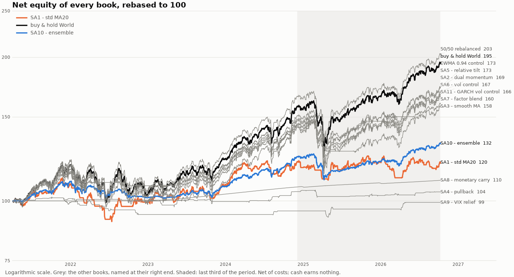

# quant-backtester

[](https://github.com/paulrivaudd/quant-backtester/actions/workflows/ci.yml)

A daily-frequency backtesting framework for systematic strategies, built around
one priority: results you can trust and reproduce.

## Results at a glance

A daily-frequency, point-in-time backtester: each decision reads only what was published at 23:00 Paris, and look-ahead is refused by construction.



| Book, 2021-04-01 to 2026-10-09, net of costs | Annualised return | Volatility | Sharpe | Max drawdown |
| --- | ---: | ---: | ---: | ---: |
| 50/50 World / S&P 500, rebalanced (reference) | 13.71% | 14.20% | 0.96 | -22.47% |
| SA6 - vol control | 9.78% | 10.87% | 0.90 | -15.72% |
| SA10 - ensemble | 5.16% | 6.00% | 0.86 | -11.76% |
| SA7 - factor blend | 8.90% | 10.80% | 0.83 | -16.36% |
| SA3 - smooth MA | 8.62% | 11.01% | 0.79 | -21.64% |

No strategy of the common ranking ([ranking.csv](results/summary/ranking.csv)) beats the rebalanced 50/50 net of costs over 2021-2026. Every session of that period had already been examined, so these results are retrospective, not out of sample. SA15 and SA16 are separate studies, on other windows and references ([SA16](results/SA16/study.md)).

[Getting started](#getting-started) · [Architecture](docs/ARCHITECTURE.md) · [Research protocol](research/PROTOCOL.md)

## Contents

- [Design goals](#design-goals)
- [Getting started](#getting-started)
- [Status](#status)
- [Layout](#layout)
- [The data layer](#the-data-layer)
- [The signals layer](#the-signals-layer)
- [A run, end to end](#a-run-end-to-end)
- [What a run records](#what-a-run-records)
- [Writing a strategy](#writing-a-strategy)
- [Running one](#running-one)
- [Research: what is left to test, and how](#research-what-is-left-to-test-and-how)
- [What a strategy may not do](#what-a-strategy-may-not-do)

The longer sections are folded: click a line starting with a triangle to open it.

## Design goals

- **No look-ahead bias** — every value is keyed by the time it became available,
  field by field: on a session `t` the open is knowable at the opening auction
  and the close only at the closing one.
- **Look-ahead made unrepresentable** — nothing above the data layer holds a
  reader it can ask about an arbitrary date. What is handed out is a
  `PointInTimeReader` fixed at one instant, whose methods take no `as_of`
  argument at all. A strategy does not even get that: it receives a decision
  context whose every part answers for the same instant, and no attribute of
  it leads back to a reader.
- **Explicit calendars** — real holidays, half days and DST, with a declared
  coverage period and an error outside it rather than an invented session. A
  signal computed after the US close trades at the following European open, and
  that gap is modelled rather than assumed away.
- **Nothing restated is stored** — no `adj_close`. Raw prices plus a corporate
  action table, adjusted at read time with the actions known at the decision
  instant.
- **Reproducible research** — `clean/` is a pure function of the raw archive and
  the committed configuration, and can be deleted and rebuilt identically. A
  provider changing its mind is logged and ignored until someone reviews the
  exact correction in a diff.
- **A window of N sessions really is N sessions** — the reader drops a session
  it cannot serve rather than returning a `NaN`, so twenty observations may span
  twenty-six sessions. A signal declares which of the two it wants, and the
  layer refuses the window rather than computing on the wrong one.
- **Explicit transaction costs** — commission, spread and slippage are named,
  configurable terms; gross and net results reported side by side.
- **A book that could have existed** — an instrument is bought only if the
  registry says it can be bought, in the currency the book is kept in, in the
  units the venue deals in, with money the book holds, and never short. Each of
  those is refused loudly rather than reported as a return: a backtest whose
  orders could not have been placed is not a pessimistic backtest, it is a
  different strategy.
- **Target and actual are two things** — what a strategy asked for, what the
  portfolio allowed, what was filled and what is held are four records, not
  one number overwritten three times. A report that only kept the last would
  describe a strategy that never met a missing price, a lot size or a limit.

## Getting started

Requires [uv](https://docs.astral.sh/uv/) and Python 3.12, on a POSIX system -
Linux, macOS or WSL. The market data store is locked with `flock`, which has
the shared mode a reading run needs and which native Windows does not
provide; importing the store there fails with a message saying so.

```bash
uv sync                          # create the environment from uv.lock
uv sync --extra ml               # the same, with PyTorch (CPU) for SA14
uv sync --extra stats            # the same, with arch and statsmodels for SA11 and SA12
uv sync --extra ml --extra stats --extra signatures   # everything, SA13 (log-signatures) included
git config core.hooksPath .githooks   # once per clone: the commit-message hook
uv run pytest                    # offline suite
uv run pytest -m network         # the live provider checks, opt in
uv run ruff check . && uv run ruff format --check .
uv run pyright
```

A first backtest needs no download. `scripts/demo.py` writes two invented
funds, drawn from a fixed seed, to a temporary store, and runs `SA1` - a fund
held above its 20-session average - and a buy-and-hold of the same fund over
them with the project's own reader, engine, execution model and report
(`quant_backtester.demo`). The prices are not market data; the machinery is the
real one:

```bash
uv run python scripts/demo.py                      # both reports, a few seconds
uv run python scripts/demo.py --figures demo_output  # and the equity and drawdown figures
```

```python
from pathlib import Path

from quant_backtester.demo import demo_runner
from quant_backtester.strategies import WorldMA20Benchmark

runner = demo_runner(Path("demo_store"), seed=20240101)  # a new, empty directory
result = runner.run(
    WorldMA20Benchmark(instrument_id="FUND_A"),  # SA1
    ("FUND_A", "FUND_B"),
    "2025-01-02",
    "2025-12-31",
)
print(result.report().render())
```

For real data, fetch the committed instruments into the local store, then read
it at a decision instant:

```bash
uv run python scripts/update_market_data.py              # extend every series
uv run python scripts/update_market_data.py --rebuild    # replay raw/ into clean/
uv run python scripts/update_market_data.py --archive --only ETF_WORLD
uv run python scripts/update_market_data.py --coverage   # what the store is missing
```

```python
from datetime import datetime
from pathlib import Path
from zoneinfo import ZoneInfo

from quant_backtester.data.calendars import CalendarRegistry
from quant_backtester.data.instruments import InstrumentRegistry
from quant_backtester.data.reader import MarketDataReader
from quant_backtester.data.repository import MarketDataRepository
from quant_backtester.data.universes import UniverseRegistry

root = Path("market_data")
instruments = InstrumentRegistry.from_toml(root / "metadata" / "instruments.toml")
calendars = CalendarRegistry.from_directory(root / "metadata" / "calendars")
reader = MarketDataReader(
    repository=MarketDataRepository(root),
    instruments=instruments,
    calendars=calendars,
    reference_calendar_id="XPAR",
)
universes = UniverseRegistry.from_toml(root / "metadata" / "universes.toml", instruments)

# 23:00 in Paris: the US and European closes of the day are knowable.
decision = reader.at(datetime(2026, 9, 17, 23, 0, tzinfo=ZoneInfo("Europe/Paris")))
prices = decision.history("SP500")  # nothing after the decision instant
state = decision.values(["SP500", "VIX"])  # value, age in sessions, and why
```

## Status

The **market data layer is complete and in use**: providers, calendars, a local
Parquet store, validation, multi-source cross-checking, a revision policy and a
point-in-time reader. It ingests six instruments end to end, with dated
universe memberships, and deleting the derived layer and rebuilding it from the
raw archive gives the same files byte for byte.

The **signals layer has its first version**: a window loader that refuses a
window which is not what it claims to be, six signals computed from a fund's
own window — return, momentum, moving-average trend, realised volatility,
current drawdown and mean reversion — two more for published series, a
cross-sectional ranking over any of them, and a universe per signal so a gauge
can reach the same decision as the funds it gates.

**Writing a strategy is the point, and it takes about fifteen lines.** A
strategy declares the signals it needs and answers one question - what to hold,
at an instant it did not choose. What it is handed is a decision context: those
signals, a market façade whose every reading carries its status and its age,
the book as it stands, and the names it is allowed to hold. What it is not
handed is a reader, so there is no expression it can write that reads tomorrow.
A runner takes it from there - any period, warm-up included, with the
configuration recorded beside the numbers - and the result draws itself against
whatever it should be measured against.

**Portfolio, execution and the event loop turn a decision into a book that could
have existed, and keep every step of the way.** What the strategy asked for,
what the portfolio allowed of it, the orders that produced, the fills and the
refusals with their reasons, the positions with what they cost, and how the
book was valued - one immutable record per session, from which every table of
a run is built. The economics are enforced rather than assumed: the trading
universe holds only instruments the registry says can be bought, all quoted in
the book's own currency and checked before the first session; weights are
long-only fractions of one book; a purchase is sized at the price it will be
paid; every order is a whole number of lots rounded down, so a trade is
truncated towards zero and a position ends within a lot of its target; the
sales pay for the purchases; cash cannot go below zero; an order is only ever
filled at an opening price of its own session; and a book asked to keep what it
holds sends no order at all.

**Analytics has its first version**: equity curves, drawdowns, the usual ratios,
the split of what execution took, and the caveats a run has to be read with.
None of it reaches back into the market data — it reads a finished run, and a
figure the run cannot support is reported as nothing rather than invented.

## Layout

Seven layers that depend on each other one way, with research, tests, scripts
and docs around them.

<details>
<summary>Show the directory tree</summary>

```
src/quant_backtester/
    data/        providers, Parquet store, trading calendars   (done)
    signals/     information -> forecast scores                (V1 done)
    portfolio/   forecast scores -> target positions           (V1 done)
    execution/   target positions -> fills and costs           (V1 done)
    backtest/    the event loop                                (V1 done)
    analytics/   performance, risk, comparison, plots           (V1 done)
    strategies/  the contract, and strategies written on it     (V1 done)
    research/    hypotheses, experiment register, archives, paper plans
    demo.py      an invented market for a first, offline backtest
tests/           mirrors the package layout
scripts/         command-line entry points (see docs/ARCHITECTURE.md §13)
docs/            architecture, data layer, formulas, corporate actions, glossary (French)
results/         one folder per strategy (SA1 ... SA16) and summary/, which compares them
runs/            what the study scripts export, run after run; not committed
market_data/     metadata/ is committed; raw/, clean/ and validation/ are not
```

Dependencies flow one way, left to right; a lower layer never imports a higher one.
The one exception is `backtest/runner.py`, the composition facade that runs a
strategy and hands back its report: it imports `strategies.base` and
`analytics`, and the layering test names it as the only module allowed to.

```text
MarketDataReader.at(decision) ──┬──> SignalContext ──> SignalEngine ──> SignalSnapshot ──┐
                                │                                                        │
                                └──> StrategyMarketView ──────────────────────────┐      │
                                                                                  ▼      ▼
                                          PortfolioView ──────────────────>  StrategyContext
                                                                                     │
                                                                          Strategy.decide()
                                                                                     │
                                                              TargetAllocation  (what it asked for)
                                                                                     │
                                                    PortfolioModel: admissible? within the limits?
                                                                                     │
                                                              ConstrainedTarget (what it may hold)
                                                                                     │
MarketDataReader.at(execution) ──> opening prices ──>  ExecutionModel: orders, fills, rejects
                                                                                     │
                                                                PortfolioState (what is held)
                                                                                     │
MarketDataReader.at(valuation) ──> closing prices ──>  value_state()  ──>  BacktestRecord
```

A strategy receives that context, never a reader: holding one, it could write
its own `tail(20)` and get twenty observations spanning twenty-six sessions, or
read a price nobody had decided was knowable yet. Every part of the context
answers for the same instant, and the construction refuses a set that does not.

</details>

## The data layer

Providers, calendars, a local Parquet store, validation, cross-checking, a
revision policy and a point-in-time reader: one module per job.

<details>
<summary>Show the modules and what each one guarantees</summary>

| Module | Role |
|---|---|
| `instruments.py` | the registry: what each series is, when it becomes public, whether it can be bought and in what units |
| `calendars.py` | sessions, real opening and closing instants in UTC |
| `sources/` | one adapter per provider: Yahoo, FRED, ECB, Euronext |
| `normalizer.py` | provider frames to canonical schemas, availability stamped |
| `validator.py` | rules typed by asset class |
| `crosscheck.py` | several sources to one checked series, field by field |
| `revisions.py` | detecting a change is not deciding to apply it |
| `corporate_actions.py` | reviewed corrections to what a provider called an event |
| `bar_corrections.py` | reviewed decisions to drop a bar a provider sent broken |
| `repository.py` | the only module that knows Parquet exists, one change at a time |
| `updater.py` | ingestion, and the replay that proves it reproducible |
| `universes.py` | who was in the universe on the day, not who is in it now |
| `reader.py` | point-in-time reads, vintage by vintage, and nothing else reaches a strategy |

Sources in use: Yahoo Finance (bars and corporate actions), FRED (published
series), ALFRED (the same series as it stood on a declared day), the ECB
reference rates, and the Euronext historical export as a second opinion on
Paris prices.

FRED serves the latest vintage of every observation. For a daily market print
that is an assumption rather than a fact - a correction after release would be
read by decisions taken before it - and for a revised aggregate it is look-ahead
bias outright: US GDP for
the first quarter of 2019 is 21 098.827 to a reader in January 2020 and
21 115.309 to one in June 2021. An instrument served by ALFRED declares the
vintages it wants and how they are read, in committed configuration, so the
same code and the same config fetch the same numbers for ever — and the adapter
refuses to fetch without them.

So every instrument declares, in `instruments.toml`, what its stored history
is: `ARCHIVED_VINTAGES` (each value as it was published - only a vintage
archive), `ASSUMED_UNREVISED` (today's telling, taken as the telling of the
time because values of this kind are not restated) or `RESTATED` (today's
telling of a series known to be revised), with a `history_note` giving the
reason. None is a default, and the loader refuses an instrument that does not
say. US10Y is declared `RESTATED`: H.15 values are occasionally corrected.

There are two honest ways to read such a series, and which one a run used
changes what it saw, so it is declared rather than inferred. `PINNED` reads one
vintage for the whole run: reproducible, and not point-in-time — a decision in
2019 sees numbers restated in 2020, which is fine for a study that says so.
`AS_OF_DECISION` stores the archive, one row per observation *and* vintage, and
each decision is given the latest vintage it could have seen. A revision
published this morning is then invisible to a decision taken last night, and
the same backtest re-run next year still hands the 2020 decision its 2020
number.

A provider occasionally sends a bar that is not a bar: an open above its own
high, a price of zero. The validator refuses the series for it, which is right,
and refusing for ever is not - one impossible row in 2017 kept four years of
good history out of the store. So the decision is committed like the others, in
`bar_corrections.toml`, with the reason on file. A correction **drops** the row
and never repairs it: nothing knows the high the market really made, and a hole
is visible where an invented price is not. Each entry names the defect it was
written for, so the day a provider fixes its own data the ingestion stops
rather than going on dropping a good bar for ever.

One promotion writes the bars, each check source's bars, the verdicts computed
from them, the revision log and the journal of applied fetches. Each write is
atomic on its own, which is not the same thing: a run that died between two of
them left a store whose verdicts described values that were no longer there —
detected by the next update, and repaired by hand. Those writes are now one
transaction, staged under `.pending/` and published together; opening the store
finishes a commit that had been decided and discards a set of files that had
not.

A dated universe is only half of the survivorship problem. The other half is
that nobody can download the prices of a name once the provider stops serving
it — so `--archive` fetches an instrument's whole declared history on purpose,
while it can be, and `--coverage` says which names the store does not hold in
full. A delisted instrument is never fetched past its last session, and never
refetched once its series reaches it: what is in the archive is all there will
ever be.

Membership is dated for the same reason prices are. A universe written as a
list of names is a list of the names that still exist — Yahoo serves nothing
for TWTR, SIVB or CELG — so `market_data/metadata/universes.toml` gives each
member a window, a name that left keeps the date it left on, and the engine
asks what the universe held on the session it is deciding on. A bound left open
in the file is closed with the instrument's own listing dates when it is read:
a fund launched in 2018 is not a member of anything in 2010.

</details>

## The signals layer

A signal is computed at one instant, over a window checked to be what it
claims, and every value comes with a status.

<details>
<summary>Show the modules and the rules</summary>

| Module | Role |
|---|---|
| `types.py` | window modes, price bases, units, and the eight statuses |
| `context.py` | what a signal may read at one instant, and nothing else |
| `windows.py` | a window of N sessions, or the reason it is not one |
| `base.py` | the contract, the result frame and its diagnostics |
| `engine.py` | several signals over one decision |
| `snapshot.py` | what a strategy receives |
| `price/`, `risk/` | the six signals computed from one instrument's own window |
| `level/` | published series: a change in their own units, a z-score |
| `cross_sectional/` | ranking those signals across a universe |
| `engine.py` | and a signal may be asked about a universe of its own |

A published series is not a price, and `level/` is where that is taken
seriously. Nobody holds sessions for a macro release, so its window is counted
in **observations available** rather than in sessions in a row - and the result
carries the dates those observations actually covered, because twenty
observations of a ten-year yield spanned twenty-nine days the last time anyone
asked. Its arithmetic differs too: a yield of 4.20 that becomes 4.45 has moved
twenty-five basis points, not six percent, and a yield that crosses zero makes
the ratio change sign while the move itself is unremarkable. So the change is a
difference in the series' own units, and two such series are compared by
standardising them, never by dividing.

A snapshot is one instant, not one universe. A `SignalRequest` carries the
names a signal is computed for — a list, or a dated universe the engine
resolves for the session being decided, because a basket of gauges changes over
the years like any other — so a rule on a fund can be gated by a volatility
index or a yield that reaches the same snapshot without ever being ranked
against it: `SA9` reads the VIX beside the fund it buys. What such a rule does
when the gauge cannot be read has to be declared too, because a risk filter
that silently becomes no filter the day its input is late is only ever noticed
afterwards.

A signal never chooses its own instant, never opens a file and never repairs a
window. Every number comes with a status, because "not listed yet", "no history
yet", "a session is missing", "the last value is too old" and "the arithmetic
does not apply" are five different things, and a `NaN` is none of them.

That is also why a ranking excludes an instrument whose own signal is not usable
rather than putting it last: "the worst of the universe" and "we do not know"
must not be the same number, or a strategy selling the bottom of a ranking would
be selling the names whose data is late.

```python
from quant_backtester.signals import (
    MomentumSignal,
    PriceBasis,
    SignalContext,
    SignalEngine,
)

context = SignalContext(market=decision, instruments=..., calendars=...)
snapshot = SignalEngine().compute(
    context,
    [
        MomentumSignal(
            signal_id="momentum_60d",
            lookback_sessions=60,
            price_basis=PriceBasis.ADJUSTED,
        )
    ],
    ["ETF_WORLD", "ETF_SP500_PEA"],
)

snapshot.value("momentum_60d", "ETF_WORLD")  # 0.0259
snapshot.status("momentum_60d", "ETF_WORLD")  # SignalStatus.OK
snapshot.result("momentum_60d").ok()  # the rows a strategy may use
```

</details>

## A run, end to end

The engine below is the primitive, and the sections after this one show the
façade that a user actually writes against. It is here because everything the
façade does is *this*, with the configuration filled in once:

<details>
<summary>Show the full example</summary>

```python
from quant_backtester.analytics import AnalyticsConfig, PerformanceReport
from quant_backtester.provenance import git_source_state

engine = BacktestEngine(
    reader=reader,
    calendars=calendars,
    strategy=BufferedDualMomentum(),  # SA2; a strategy declares its own signals
    universe=universes.get("ROTATION_2"),  # two PEA funds, dated memberships
    config=BacktestConfig(
        start=date(2025, 1, 2),
        end=date(2026, 9, 17),
        initial_cash=100_000.0,
        base_currency="EUR",
        reference_calendar="XPAR",
        schedule=EverySession(),
        timetable=BacktestTimetable(),  # fill at 09:01, value and decide at 23:00, Paris
    ),
    execution=ExecutionModel(
        costs=CostModel(
            commission_rate=0.0005,
            minimum_commission=1.0,
            half_spread_rate=0.0002,
            slippage_rate=0.0001,
        ),
        minimum_trade_value=500.0,
    ),
    portfolio=PortfolioModel(PortfolioLimits(max_weight_per_instrument=1.0, max_gross=1.0)),
    source=git_source_state(Path(".")),  # the commit, and whether the tree was clean
)
result = engine.run()
report = PerformanceReport.of(result, AnalyticsConfig(sessions_per_year=255, risk_free_rate=0.02))
print(report.render())
```

The report has the shape below. This one is the offline demo's
(`uv run python scripts/demo.py`): `SA1` on invented prices, so its numbers show
the layout and say nothing about the rule. What the catalogued strategies did on
real data is in
[results/summary](results/summary/README.md).

```text
255 sessions, 0.99 years, 255 sessions/year, risk-free 2.00%

                               gross         net
total return                   2.86%       0.22%
annualised return              2.88%       0.22%
annualised volatility         11.05%      11.23%
max drawdown                 -13.85%     -15.34%
sharpe ratio                    0.13       -0.10

relative to FUND_A (TOTAL_RETURN), 2025-01-02 to 2025-12-31
  255 valuations, 254 returns, 255 sessions/year, risk-free 2.00%
                                   gross         net
regression alpha, a year          -5.86%      -8.57%
beta                               0.515       0.523
active return, a year            -12.77%     -15.36%
tracking error, a year            10.72%      10.70%
information ratio                 -1.191      -1.435
r squared                          54.3%       54.3%
  alpha is A x the intercept, not a compounded return; the ratios scale by sqrt(A)
  FUND_A is held without costs, lots or cash left over, distributions reinvested at the close

costs                         264.40
  commission                  165.25
  spread                       66.10
  slippage                     33.05
  drag on the return           2.64%
  share of gross              92.33%
  rebalancings                    32
  per rebalancing               8.26
  turnover                    31.56x
  turnover a year             31.75x

by instrument                    net       gross        cost    held
  FUND_A                       21.97      286.37      264.40     138

sessions valued on an older price              0
sessions without an execution price            0
purchases cut for want of cash                 1
sessions with nothing to choose from           0
sessions missing a line of the target          0
average cash                              46.26%
largest weight held                       99.92%
orders, fills, rejects                 32, 32, 1
  INSUFFICIENT_CASH                            1

assumptions
  fills: OPEN_AUCTION_NOTIONAL - sized and filled at the next opening price
  gross: the same fills with no cost taken out - not a separate cost-free run
  cash: earns nothing; the risk-free rate enters the Sharpe ratio and the regression alpha and beta, nothing else
  limits: cap target weights, before costs
  a decision lives: one execution; a refused order is not retried
  history read: ASSUMED_UNREVISED FUND_A, FUND_B
```

The block relative to the benchmark is there because the demo's runner declares
one; it is read under [Running one](#running-one).

Gross and net are the same fills with and without their costs, and the costs
are three named terms. On these invented prices thirty-two orders took 264 of
the 286 euros the rule earned before them: the kind of fact a backtest without
a cost model cannot show, which is why this one refuses to report a return
without one.

The instrument block is exact: every instrument's share is computed from the
quantities, the fills and the closes the run itself recorded, and what it fails
to explain is reported rather than absorbed.

The last block is not decoration. A session valued on an older price, an order
with no execution price, a purchase cut for want of cash, a session with
nothing to choose from: each is counted, and a refused order is a reject on the
record with its reason. Those lines are the caveats the figures above have to
be read with, and a caveat is only worth what was measured about it.

Inside a session the order is fixed, and it is what stops a strategy buying at
the close it just read. The three instants are declared in the run's
`BacktestTimetable` and recorded with it:

```text
09:01 on session s   execution   the target decided on s-1 is filled at s's open
23:00 on session s   valuation   the book is marked at s's closes
23:00 on session s   decision    the signals run, and the target for s+1 is decided
```

An order is filled at an opening price **of its own session** or not at all. A
Friday decision is filled on Monday, one taken before Easter on the Tuesday
after it, and an execution time set before the auction finds only yesterday's
open - which the reader rightly calls the latest there is, and which is still
not a price anyone could trade at that morning. Valuation may estimate - a
close that did not print is marked at the last price known, and named -
execution never does.

</details>

## What a run records

One immutable `BacktestRecord` per session, and every table is a view of those:

<details>
<summary>Show the tables of a result</summary>

| Asked of a result | What it holds |
|---|---|
| `result.records` | the records themselves, the source of truth - `records()` on what a runner hands back |
| `result.frame()` | one row per session: the three instants, net and gross, target and actual invested, costs term by term |
| `result.fills()` | every trade: market price, fill price, commission, spread, slippage |
| `result.orders()` | every order the targets called for, with `FILLED`, `PARTIALLY_FILLED` or `REJECTED` |
| `result.rejects()` | every refusal with its reason: no price, a stale one, below the minimum trade, not enough cash, left the universe |
| `result.holdings()` | the quantity of every instrument and the cash, after each session |
| `result.weights()`, `result.target_weights()` | what the book actually was, against what it was traded towards |
| `result.costs()`, `result.equity()` | the bill per session, and the two books |

A decision is kept whole: what the strategy returned - with how many
instruments it chose among and why the others were not eligible - and what
the portfolio allowed of it. A limit that cut a weight says which limit it was;
an instrument the book may not hold at all is not cut to nothing, it stops the
run. Positions carry the average price actually paid for them, costs included,
which is what a stop or a take-profit is measured against.

The run also records what it was made with - period, universe, calendar,
schedule, timetable, limits, cost and execution models, the lot size of every
instrument it could hold, the strategy's definition and fingerprint - and the
state of the code: the commit and whether the tree had uncommitted changes, as
`git_source_state` found them when the script that ran it asked. The library
never shells out to git on its own.

What this version does not model is refused rather than approximated. A split
or a dividend on a position the book holds stops the run: the funds traded here
accumulate and have not split, and a position halving overnight, or a dividend
that never reached the cash, would be worse than a run that says it cannot
continue. Execution is the next open and nothing else; the book is long-only
and kept in one currency.

</details>

## Writing a strategy

A strategy is a name, the signals it needs, and one decision:

<details>
<summary>Show an example and the context it is handed</summary>

```python
from quant_backtester.strategies import Strategy


class GatedRotation(Strategy):
    strategy_id = "gated_rotation"

    def required_signals(self):
        momentum = MomentumSignal(
            signal_id="mom60", lookback_sessions=60, price_basis=PriceBasis.ADJUSTED
        )
        return (
            momentum,
            CrossSectionalRank(signal_id="rank", source=momentum),
            SignalRequest(LevelZScoreSignal(signal_id="vix_z", window_observations=60), ("VIX",)),
        )

    def decide(self, ctx):
        gauge = ctx.signal_value_or_none("vix_z", "VIX")
        if gauge is None or gauge > 1.5:
            return ctx.cash()
        return ctx.equal_weight(ctx.top("rank", 2))
```

Nothing in it knows that Parquet, Yahoo, corporate actions, trading calendars
or fill prices exist. `ctx` is the decision instant, and everything in it
answers for that instant:

| What it holds | For |
|---|---|
| `ctx.signals` | the snapshot, read through `signal_value`, `signal_status`, `top`, `bottom`, `where` |
| `ctx.market` | the latest value of any series, and windows of it |
| `ctx.portfolio` | the book as it stands: cash, positions, weights |
| `ctx.universe` | the names this session's universe allows |

and the decision is expressed through `ctx.weights`, `ctx.equal_weight`,
`ctx.cash` and `ctx.hold_positions`, which refuse a book nobody could hold: a
negative weight, a sum above one, a name outside the universe, an instrument
the registry declares untradable.

`ctx.market` exists so that a rule like *stand aside above thirty* does not
need a new signal class. It costs nothing in safety, because staleness is never
hidden:

```python
vix = ctx.market.value("VIX")
if not vix.usable(max_age_sessions=1):
    return ctx.hold_positions()
if vix.value > 30:
    return ctx.cash()
```

A reading carries its status, the day it describes and its age in sessions, and
`require()` refuses to hand back a number that is too old rather than returning
a stale one. A window goes through the loader every signal uses, so twenty
observations spanning twenty-six sessions are refused here exactly as they are
there. The rule of thumb: a *decision* belongs in a strategy, and a
*transformation* worth reusing belongs in a signal.

`hold_positions()` is there for the day a signal cannot be computed. Standing
aside and not trading on bad data are both defensible, they are different
strategies, and a framework offering only `cash()` would quietly make every
strategy choose the first. It keeps the positions and sends no order - which is
not the same as asking for the weights the book has: those are the weights of
the close, two funds drift apart overnight, and a target restated in weights
trades that drift every morning. An earlier version did exactly that, and only
the minimum trade value kept it still: without one, buy and hold on two funds
traded 106 times in twenty-one months instead of once. A risk limit the kept
book breaches still trades it down to the limit.

It is also what makes a baseline honest. `BuyAndHold` buys its basket, completes
it with the cash left if a name could not be bought the first time
(`ctx.keep_and_buy`: the names held are kept, never traded back to equal
weights), and keeps its positions afterwards; `EqualWeightRebalance` restates
the same target at every decision. They are two different strategies - the
first trades once, the second whenever the funds have drifted apart - and
calling the second one "buy and hold", as an earlier version of this project
did, hides the very thing the comparison exists to measure. Both are the
reference books of every study of the catalogued strategies.

</details>

## Running one

A runner takes a strategy, a universe and a period, and hands back the run with
its configuration, its report and its comparison to a benchmark.

<details>
<summary>Show the runner, the report and the comparison</summary>

```python
runner = StrategyRunner(
    reader=reader,
    calendars=calendars,
    reference_calendar_id="XPAR",
    base_currency="EUR",
    analytics=AnalyticsConfig(sessions_per_year=255, risk_free_rate=0.02),
    execution=ExecutionModel(costs=CostModel(commission_rate=0.0005, minimum_commission=1.0)),
    universes=universes,
    initial_cash=100_000.0,
    source=git_source_state(Path(".")),
    benchmark="ETF_WORLD",
)

result = runner.run(
    BufferedDualMomentum(),  # SA2
    universe="ROTATION_2",
    start="2025-01-02",
    end="2026-09-17",
)

result.report().render()
result.plot()  # against the declared benchmark
result.compare().render()
result.fills(), result.holdings(), result.rejects()
```

The cost model is required: a runner that defaulted to free trading would
report returns no account could have had, from a line nobody wrote.

Every strategy the package exports is runnable as it stands: it declares the
signals it reads, so those four arguments are the whole of what a user writes.
A rule needing its signals wired in from outside would look identical in an
import list and fail at the first decision, so there is no such thing.

`start` is where the *performance* starts, not where the data does: a
sixty-session momentum run from January reads the previous October, because the
reader has always been allowed to look back and never forward. A bound that is
not a session moves inwards to one that is. And the result carries what the
numbers depend on — period, universe, calendar, rebalancing schedule, starting
cash, limits, costs, fill model and timetable, annualisation convention — beside
the strategy's own definition and fingerprint, because a Sharpe ratio without
them is not a result. All of it frozen: a record of an experiment that can be
edited afterwards is a record of nothing.

The data is part of it too. A run holds the store for reading from its first
session to its last - an ingestion started meanwhile is refused, not
interleaved - and records the SHA-256 of every file under `clean/` and
`metadata/`. The declared benchmark is valued inside that hold and kept; any
other benchmark asked for later is valued only if the store still has the same
digest, and `StoreChanged` is raised otherwise, since a revised close would
otherwise move the conclusion of a finished run. `run_id` hashes the whole
record - the calendars and instruments the run was handed, and its
environment: Python, the digest of `uv.lock` and the versions of the numerical
libraries: the same question asked of other data, or in another environment,
is another run.

A fingerprint hashes a *configuration*, never the source that read it, so two
runs of an edited `decide` share one. What tells them apart is the state of the
code - the commit, and whether the tree had changes nobody committed - given
to the runner and recorded as given, `UNRECORDED` when nobody said. Scripts get
it from `git_source_state`; the library never guesses it. Nor does a
fingerprint see what a function closes over: the engine checks that the
declared definition did not change during a run, and a counter kept in a
closure changes the decisions without changing it. Build a fresh strategy per
run.

The rebalancing calendar is declared per run rather than inside the strategy,
so one rule can be tested at several frequencies without being written twice:

```python
runner.run(strategy, "ROTATION_2", "2025-01-02", "2026-09-17", schedule=Monthly())
```

On a session the schedule does not decide on, the strategy is not called, no
order is sent, and the record carries the target still standing with
`decided = False` beside it.

`result.compare()` measures the run against its benchmark. On the demo's
invented prices, `SA1` against the fund it trades:

```text
255 sessions, strategy against FUND_A

                            strategy        FUND_A
total return                   0.22%        16.07%
annualised return              0.22%        16.18%
annualised volatility         11.23%        15.83%
max drawdown                 -15.34%       -10.13%
sharpe ratio                   -0.10          0.90
excess return                -15.85%

relative to FUND_A (TOTAL_RETURN), 2025-01-02 to 2025-12-31
  255 valuations, 254 returns, 255 sessions/year, risk-free 2.00%
book                                 net
regression alpha, a year          -8.57%
beta                               0.523
active return, a year            -15.36%
tracking error, a year            10.70%
information ratio                 -1.435
r squared                          54.3%
  alpha is A x the intercept, not a compounded return; the ratios scale by sqrt(A)

FUND_A is a yardstick, not an alternative that was traded: one share
held from the first close, with no cost, no lot and no cash left over. The
strategy starts in cash and trades at the next open on its own schedule.
```

The second block measures the strategy *relative* to the benchmark, on the
simple returns of the 254 sessions both curves share
(`quant_backtester.analytics.relative`). **Beta** is the slope of the least
squares fit of the strategy's excess return over the risk-free rate on the
benchmark's: 0.523 here, for a book whose cash averaged 46%. **Alpha** is the intercept of that fit multiplied by the 255 sessions
of a year. It is a scaled coefficient and not a compounded return, and against
a benchmark other than the market it is a regression alpha, not Jensen's. The
**active return** is the mean of the daily difference of the two returns,
annualised the same way; the **tracking error** is its spread times the root
of 255; the **information ratio** is their quotient. None of the three is the
`excess return` line above, which is a difference of total returns. A figure the
sample cannot identify - under the declared `minimum_sessions`, a benchmark
that does not move, a constant active return - is a dash with its reason,
never a zero. `result.report()` shows the same figures gross and net side by
side, `result.compare(book=Book.GROSS)` the gross ones alone, and
`result.report(benchmark=...)` measures the same run against another yardstick
without touching the report it keeps. The formulas are in `docs/FORMULES.md`.

`result.plot()` draws the run against its benchmark. It returns a figure and
never calls `show`, so a notebook displays it, a script saves it and a test
inspects it.

An index is a yardstick; the fund a strategy could actually have bought
instead, under the same costs, lots and cash, is a control, and whether the gap
between two books means anything is a question for a paired block bootstrap of
their returns (`quant_backtester.analytics.uncertainty`). The studies of the
catalogued strategies report one with every comparison, beside a second run at
twice the declared costs: see
[results/summary](results/summary/README.md).

The benchmark is read at the run's own decision instants, so adding data after
the last session changes none of its figures; a session its venue did not hold
is marked at the last close that existed and named; and one quoted in another
currency is refused rather than drawn, because without an FX conversion the
difference between the two curves is an exchange rate.

</details>

## Research: what is left to test, and how

Every session of 2018 to 2026 on `ROTATION_2` has been looked at, and those
results shaped choices, so none of that history is out of sample any more. The
test left is the future. [`research/PROTOCOL.md`](research/PROTOCOL.md) writes
the rules down before any experiment they govern:

- a hypothesis written in `research/hypotheses.toml` before its first run,
  with what would refute it, and a status that answers that question and
  nothing wider;
- a study that counts the configurations it ran and deflates its Sharpe ratios
  by that number, so a result is read with the variants it took. The register
  that counted every run of the project was removed on 2026-10-11: a variant
  tried outside a study is counted nowhere;
- a strategy kept for observation run forward on paper, its configuration
  frozen, and not read before a year of sessions. The two plans committed for
  2026-10-01 were closed before any session was logged, and removed with the
  code that ran them;
- neighbourhoods rather than points, rolling start dates, twice the costs, and
  an executable baseline over the same sessions before any variant is kept.

### SA15: five series of ETF studies

SA15 ran five retrospective series against S&P 500, then Nasdaq-100, buy and
hold; the last selection archived is trial 71 of the fourth series.

<details>
<summary>Read the five series</summary>

SA15_GPT-6.1 adds a bounded, retrospective multi-asset ETF momentum study:
[protocol](research/SA15_GPT-6.1/protocol.md),
[data notes](research/SA15_GPT-6.1/data.md), and
[results and all ten trials](results/SA15_GPT-6.1/study.md).
The study uses an isolated data store, evening decisions and next-opening
execution, without leverage. Run `scripts/SA15_download_data.py` first, then
`scripts/SA15_run_gpt61_study.py` with the numbered candidate JSON files;
freeze the selection with `--final`. Research defaults in `SA15GPT61()`
describe trial 1; use the retained candidate in `selected.json` to run the
selected policy. The reserved final period was previously examined elsewhere
in this project, and its results are not prospective evidence.


The second SA15 series targets S&P 500 buy-and-hold explicitly:
[round-two protocol](research/SA15_GPT-6.1/round2/protocol.md) and
[ten further trials and results](results/SA15_GPT-6.1_R2/study.md).
It keeps the first series intact. The retained policy is loaded from the new
study's `selected.json`, rather than the prototype defaults of
`SA15RelativeMomentum`. Its schedule makes an initial decision on the first
session, then evaluates at month ends; orders execute at the next open.
Use `scripts/SA15_run_gpt61_round2.py` for numbered candidates 11–20,
`--final` to freeze, and `--robustness` for fixed-policy diagnostics.
The Nasdaq and the initial 50/50 S&P 500/Nasdaq buy-and-hold controls are
reported alongside S&P 500. All of this history has already been examined.

#### SA15: third series against Nasdaq buy and hold

The third study keeps the first two series intact and treats 100% Nasdaq
buy and hold as its main return benchmark. Ten new designs, numbered 21–30,
are declared sequentially in
[the R3 protocol](research/SA15_GPT-6.1/round3/protocol.md).
The Nasdaq default, conditional defence, fast recovery and optional relative
rotation are implemented in `SA15NasdaqAdaptive`; its prototype defaults do
not replace the selected configuration in `results/SA15_GPT-6.1_R3/selected.json`.

Use `scripts/SA15_run_gpt61_round3.py --candidate <spec>` for each design,
then `--final` and `--robustness`. The runner requires all ten candidates,
verifies the evidence against Nasdaq and freezes its financial dependencies
before the first candidate. `scripts/SA15_report_gpt61_round3.py` only reads
saved results. The [R3 report](results/SA15_GPT-6.1_R3/study.md) includes
cost stress, actual trading dates and the previous simple controls.
All periods have already been examined; these are retrospective experiments.

#### SA15: fifty variants with risk and trading preferences

The fourth study runs fifty new designs, numbered 31–80, against Nasdaq buy
and hold. Its [protocol](research/SA15_GPT-6.1/round4/protocol.md) fixes a
continuous 2019–2024 selection book, a 25% historical drawdown target and at
most four trading dates per year. These are research targets, not future risk
limits. The final 2025–2026 and full-history runs follow selection freeze.

`SA15RiskAwareRotation` combines fixed or inverse-volatility balanced holdings,
momentum rotation, trend votes or offensive volatility control, with explicit
optional canaries. The selected JSON contains all parameters. New accumulating
technology, health-care and utilities funds live in the isolated R4 store;
previous studies' price files stay unchanged. Technology buy and hold and
Nasdaq/gold buy and hold are reported as composition controls.

Use `scripts/SA15_download_gpt61_round4.py` for data, then
`scripts/SA15_run_gpt61_round4.py --candidates` with each announced batch of
ten JSON files. After all fifty, freeze descriptive companions, run `--final`,
then `--robustness --workers 3` and the companion diagnostics. The
[read-only report](results/SA15_GPT-6.1_R4/study.md) is generated by
`scripts/SA15_report_gpt61_round4.py`; it includes every design and the Pareto
frontier. The history has already been examined, so conclusions remain
retrospective.

#### SA15: iterations by quantitative blocks

New work follows the [mechanism protocol](research/SA15_GPT-6.1/mechanism_protocol.md).
Each iteration states a block's hypothesis before running it, replays matched
controls with that block disabled, measures benefits and costs, then records the
specific defect that motivates the next mechanism. Asset weights are outputs of
past-information rules; grids of historical winning portfolio weights are not
part of this process.

The first [mechanism pilot](research/SA15_GPT-6.1/mechanism_pilot/hypothesis.json)
fixes Nasdaq plus EUR monetary/cash, MA200 and a 20% offensive volatility cap.
`scripts/SA15_mechanism_pilot.py --run` executes one assembly and four controls
on three periods at base and doubled costs: thirty declared simulations, with
source/data/configuration frozen first. It refuses an existing output folder.
`scripts/SA15_report_mechanism_pilot.py` reads those saved results for the
[block analysis](results/SA15_GPT-6.1_mechanism_pilot/study.md); it does not run or
select a strategy. The periods are already explored and remain retrospective.

#### SA15: fifty iterations with block attribution

[Fifty further mechanism iterations](research/SA15_GPT-6.1/round5/protocol.md),
M01–M50, were then planned; the series stopped after M34. Their parent is the fixed pilot. Every new JSON states one changed
block, an expected benefit and cost, and a refutation before its run. All active
blocks are removed in matched controls, with base and doubled costs. An analysis linked by SHA-256 to the
completed evidence is required before the next iteration.

Use `scripts/SA15_run_gpt61_mechanisms.py --candidate <json>` for each sequential
design, and `scripts/SA15_report_gpt61_mechanisms.py --iteration Mxx` to read its
block effects. The source, data, universe, numeric constants and selection score
are frozen before M01. The four admissible funds remain Nasdaq, EUR monetary,
gold ETC and currency-hedged government bonds; only declared signal rules can
allocate them. No asset-weight grid or ex-post annual weights are fitted.

The executable rule is [`SA15Mechanisms`](src/quant_backtester/strategies/SA15_gpt61_mechanisms.py).
Its constructor defaults describe the pilot. R5 stopped after M34, before any
freeze: [`results/SA15_GPT-6.1_R5/`](results/SA15_GPT-6.1_R5/) holds the evidence
of those 34 iterations, with no `selected.json` and no report.

The planned end of the series - `--freeze` recording the sole candidate after
all fifty analyses, then `--final` and `--robustness` - was never reached, so
there is no R5 report; the archived audit-serialization attempt is kept in
`results/SA15_GPT-6.1_R5_attempt01_audit_timestamp_error/`. A new reproduction uses a new output
directory; existing evidence is never silently replaced. All periods remain
retrospective.

</details>

### SA16: technology and gold under a budget of risk

US technology and gold held together under a 75/25 risk budget; it beats
Nasdaq-100 held and SA15's archived selection on 2018-08 to 2026-10 net of
costs, with a Sharpe edge established and a return edge that is not
([study](results/SA16/study.md)).

<details>
<summary>Read the summary of the study</summary>

SA16 ([study](results/SA16/study.md), [protocol](research/SA16/protocol.md))
was run against two fixed references: Nasdaq-100 bought and held, and SA15's
last archived selection (R4 trial 71; R5 stopped at M34 without a selection).
Three of the ten allowed candidates were used, failures kept:

- it1, a stepwise trend rule on the Nasdaq read at the New York close, was not supported;
- it2, the retained configuration, holds US technology and gold together at
  inverse-volatility weights scaled by a 75/25 risk budget, rebalanced weekly
  through a 5-point band;
- it3, the same budget tilted by 6-month relative momentum, was not supported.

On 2018-08-01 to 2026-10-30, net of costs, it2 returns 22.40% a year against
19.09% and 20.97%, with a Sharpe ratio of 1.321 against 0.942 and 1.064 and a
maximum drawdown of -22.3% against -31.3% and -25.7%. The ordering holds at
doubled costs, for 7 of 7 declared neighbours and for 7 of 7 restarts from
cash. Its Sharpe edge has a paired-bootstrap interval above zero; its return
edge does not, and it comes from the technology fund chosen by SA15 after the
fact. Technology held alone returns more (24.14%) with a -31.4% drawdown. The
volatility it sizes with is `SpanScaledVolatilitySignal`, which tolerates a
session the provider did not serve. The class is `SA16RiskBudget`, catalogued
`SA16 - growth gold budget`; the frozen configuration is
[`results/SA16/selected.json`](results/SA16/selected.json). The store is
`runs/sa16_store` (`scripts/SA16_download_data.py`), and the study is run by
`scripts/SA16_run_study.py` (phases `reproduce`, `references`, `candidate`,
`robustness`, `finalise`) and `scripts/SA16_report.py`. Every period had been
looked at before: the result is retrospective.

</details>

## What a strategy may not do

Both names of `ROTATION_2` are funds a PEA can hold, in euros, on Euronext
Paris. The S&P 500 index itself is in the registry and is declared
`tradable = false`: a signal may read it, `ctx.market` may read it, and
`ctx.weights({"SP500": 1.0})` is refused — as is a run that puts it in a
trading universe at all. An earlier version of this README rotated into the
index, and its orders were simply never sent: 216 sessions of a 437-session
run, reported as a strategy.

A name whose signal is not usable is never held, and the allocation says which
of the reasons it was. A rotation meant to hold two names that can only find
one holds it at half the capital rather than doubling a bet because a provider
was late.

An allocation is also a thing a portfolio could hold, checked where it is
built: a weight is a finite fraction between zero and one, the selection and
the weights describe the same book, and the count of instruments considered
cannot be below the number chosen. A forecast model produces negative scores
for half a universe by construction, and the keystroke that turns one into a
weight is a short position nobody financed — so the refusal is at the boundary
rather than in a comment.

Four tests stand behind those sentences rather than the prose: a strategy that
imports the data layer or a network library fails the build, the context hands
back no reader, a decision taken on a store that knows what happens tomorrow is
identical to one taken without it, and every part of a context must answer for
the same instant or it cannot be built.

Other scripts: a study script named after its strategy's code runs that
strategy with its controls (`SA11_run_garch_study.py`,
`SA12_run_arima_garch_study.py`, `SA13_run_signature_study.py`,
`SA14_run_neural_strategy.py`), `run_etf_strategies_comparison.py` runs `SA1` to
`SA10` on one period, `write_strategy_reports.py` writes the reports,
`generate_calendars.py` rewrites the committed calendars from
`exchange_calendars`, `check_calendar_coverage.py` says when they need
extending, and `accept_revision.py` builds the entry that approves one detected
correction. The two reports printed in this README come from
`scripts/demo.py`.

Development rules live in [CLAUDE.md](CLAUDE.md).
