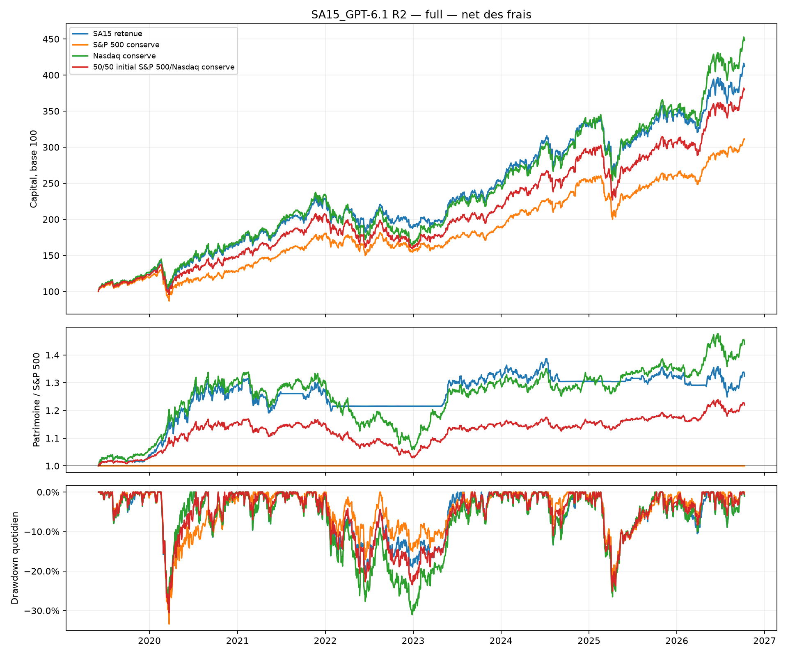
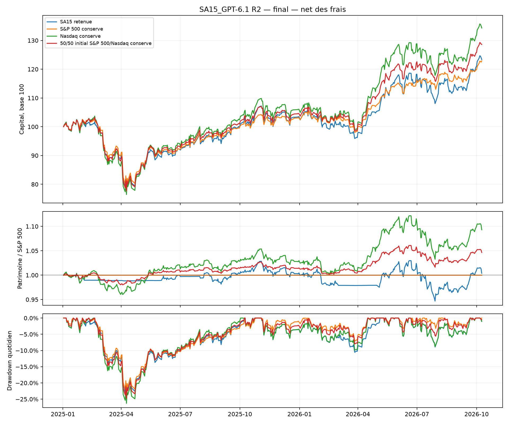

# SA15_GPT-6.1 — seconde serie — 15 octobre 2026

Statut de l'objectif de surperformance nette du S&P 500 conserve : **UNCERTAIN**.
Configuration gelee : **essai 17**, parmi 10 configurations de cette serie,
soit **20 configurations annoncees au total** avec la premiere serie.
Motif du statut : l'avantage disparait aux frais doubles face au S&P 500 standard; l'intervalle bootstrap de rendement actif moyen contient zero.

L'ecart net total au S&P 500 est **100.59 points** sur l'historique
continu et **0.47 points** sur le controle chronologique.
Pour 100,000 EUR de depart, cela represente respectivement
**100,585 EUR** et **469 EUR** de capital terminal
supplementaire ou manquant. Les resultats sont nets des frais simules, avant fiscalite personnelle.

## Historique continu : 3 juin 2019 au 9 octobre 2026

| Livre | Net total | CAGR | Volatilite | Sharpe | Drawdown | Frais EUR |
| --- | --- | --- | --- | --- | --- | --- |
| SA15 retenue | 312.00 % | 21.24 % | 19.01 % | 1.09 | -28.33 % | 5964 |
| S&P 500 conserve | 211.42 % | 16.71 % | 16.77 % | 0.99 | -33.42 % | 99 |
| Nasdaq conserve | 348.00 % | 22.63 % | 20.49 % | 1.08 | -31.05 % | 98 |
| 50/50 initial S&P 500/Nasdaq conserve | 279.70 % | 19.90 % | 18.44 % | 1.06 | -30.55 % | 98 |

Ce parcours inclut developpement, selection et controle. Il decrit le gagnant retrospectif.
Le Nasdaq conserve et le 50/50 initial conserve servent a distinguer une prime de concentration
d'une contribution de la rotation. Le 50/50 n'est pas reequilibre apres l'achat initial.

## Controle chronologique : 2 janvier 2025 au 9 octobre 2026

| Livre | Net total | CAGR | Volatilite | Sharpe | Drawdown | Frais EUR |
| --- | --- | --- | --- | --- | --- | --- |
| SA15 retenue | 23.36 % | 12.62 % | 18.52 % | 0.72 | -23.85 % | 1263 |
| S&P 500 conserve | 22.89 % | 12.38 % | 15.38 % | 0.82 | -23.16 % | 99 |
| Nasdaq conserve | 34.32 % | 18.19 % | 19.72 % | 0.93 | -26.30 % | 98 |
| 50/50 initial S&P 500/Nasdaq conserve | 28.60 % | 15.31 % | 17.34 % | 0.90 | -24.74 % | 99 |

L'alpha annuel de regression au S&P 500 vaut **-0.99 %**,
avec beta **1.14**. Le patrimoine relatif termine a
**1.0038** fois celui du S&P 500.
Alpha, difference de rendements totaux et ratio de patrimoines ne mesurent pas la meme chose.
Une exposition plus forte a la croissance et aux grandes valeurs technologiques peut expliquer
une surperformance ; un alpha contre un seul indice ne prouve pas une capacite de timing.

## Configuration effectivement retenue

Classe sauvegardee : quant_backtester.strategies.SA15_gpt61_relative.SA15RelativeMomentum.
Les valeurs par defaut de la classe sont un prototype ; elles ne remplacent pas la configuration
selectionnee. Le tableau vient des parametres complets de la definition finale gelee, verifies
contre selected.json et son empreinte **506276a51fb37956218574265a3e2c6f5d054cb34f4872a9fa924663843d492b**.
Le fichier candidat enregistre les changements demandes ; le tableau inclut aussi les valeurs
heritees du prototype.

| Parametre gele | Valeur effective |
| --- | --- |
| core_id | "ETF_SP500_PEA" |
| satellite_ids | ["ETF_NASDAQ"] |
| monetary_id | "ETF_MONETARY_EUR" |
| core_fraction | 0 |
| top_k | 1 |
| momentum_lookbacks | [126, 252] |
| momentum_weights | [1, 1] |
| skip_recent_sessions | 0 |
| minimum_relative_momentum | 0 |
| switch_buffer | 0.02 |
| rebalance_band | 0.08 |
| absolute_filter | true |
| satellite_cap | 1 |
| core_crash_lookback | 63 |
| core_crash_threshold | -1 |
| defensive_fraction | 1 |
| max_age_sessions | 1 |
| strategy_id | "SA15_GPT-6.1_R2" |

La regle retenue est une rotation entre le Nasdaq 100 et le S&P 500. Lorsque les endpoints sont disponibles, on calcule pour chaque indice :

S_actif(t) = 0.5 * [log(P_t / P_(t-126)) + log(P_t / P_(t-252))], sur les cours ajustes.

**Si S_Nasdaq > 0 et S_Nasdaq > S_SP500, la cible est 100 % Nasdaq. Sinon, la cible est 100 % S&P 500.** L'evaluation a lieu au demarrage puis apres la derniere cloture de chaque mois ; les ordres partent pour l'ouverture suivante. Avec ce seul satellite, le tampon de remplacement entre satellites n'ajoute pas de seuil d'entree. Aucun levier ni poche de cash tactique n'est active dans cette configuration ; le cash residuel vient des parts entieres, des frais et de l'attente initiale avant execution. Les refus de signaux restent soumis au contrat du moteur.

Frequence : **monthly**.
L'allocation initiale est decidee des la premiere seance du backtest, puis la cadence
mensuelle reprend aux fins de mois ; la variante hebdomadaire suit le meme principe.
Les parts sont achetees a l'ouverture negociable suivante : aucune attente artificielle
d'un mois en cash n'est ajoutee face au S&P 500 conserve.
Decision : **23:00:00, Europe/Paris**.
Execution : ouverture de la seance suivante, instant moteur **09:01:00**.
Les ordres sont prepares apres les clotures, sans levier ni vente a decouvert.
Le coeur S&P 500 reste le point de repli lorsque les satellites ne montrent pas d'avantage relatif.
Le momentum relatif utilise les prix ajustes aux endpoints exacts des horizons de seances :
un trou interieur n'est pas comble, et un endpoint absent refuse le signal.
Ce contrat differe du signal a fenetres strictement consecutives de la premiere serie.

## Dix iterations autorisees : tous les essais termines

Les exces sont des differences de CAGR au S&P 500 sur les memes dates.
Priorite aux deux exces strictement positifs, puis score decroissant, puis premier numero.
Score = moyenne(exces developpement, exces selection) - 0.25 * ecart absolu des deux exces.
Le rapport lit les resultats sauves ; il ne choisit pas de nouveau gagnant.

| Essai | CAGR dev. | Exces dev. | CAGR selection | Exces selection | Deux positifs | Score | DSR |
| --- | --- | --- | --- | --- | --- | --- | --- |
| 11 | 8.24 % | -4.66 % | 23.34 % | -3.16 % | non | -0.0429 | 0.981 |
| 12 | 16.37 % | 3.46 % | 28.23 % | 1.73 % | oui | 0.0216 | 0.990 |
| 13 | 17.97 % | 5.07 % | 29.10 % | 2.60 % | oui | 0.0321 | 0.987 |
| 14 | 19.55 % | 6.64 % | 29.95 % | 3.44 % | oui | 0.0424 | 0.983 |
| 15 | 12.88 % | -0.03 % | 20.34 % | -6.17 % | non | -0.0463 | 0.971 |
| 16 | 18.94 % | 6.03 % | 28.65 % | 2.15 % | oui | 0.0312 | 0.985 |
| 17 | 19.23 % | 6.33 % | 31.11 % | 4.60 % | oui | 0.0503 | 0.987 |
| 18 | 16.98 % | 4.07 % | 28.97 % | 2.47 % | oui | 0.0287 | 0.983 |
| 19 | 19.23 % | 6.33 % | 30.65 % | 4.15 % | oui | 0.0469 | 0.986 |
| 20 | 17.96 % | 5.06 % | 30.19 % | 3.69 % | oui | 0.0403 | 0.988 |

11. Nouveau point de départ : conserver 50% au moins en S&P 500 et placer la poche de 50% sur le meilleur momentum relatif positif, sinon au S&P 500. Décision mensuelle, tampon de 2 points pour limiter les rotations.
12. L'essai11 sous-performe le S&P500 de4.66 et3.16 points annualisés : les rotations entre quatre satellites détruisent de la performance. Isoler le satellite Nasdaq, sans changer coeur50%, horizons, tampon ou fréquence, pour vérifier la valeur du seul tilt croissance.
13. L'essai12 Nasdaq seul bat le S&P500 dans les deux périodes (+3.46/+1.73 points de CAGR). Augmenter la poche relative de50% à75% (coeur25%) pour vérifier si cette prime reste positive avec plus d'exposition, sans changer les règles de timing.
14. Le coeur25% (essai13) augmente l'excès net dans les deux périodes à+5.07/+2.60 points de CAGR. Tester la rotation entièrement investie sur Nasdaq quand son momentum relatif est positif, sinon S&P500 (coeurminimum0%), sans levier.
15. L'essai14 Nasdaq/S&P500 gagne+6.64/+3.44 points annualisés contre le S&P500, mais concentre le risque actions. Tester deux poches indépendantes Nasdaq et or (top2), chaque poche non éligible revenant au S&P500, pour voir si la diversification préserve l'excès.
16. Tester la réactivité de la meilleure rotation Nasdaq/S&P500 (essai14) : retirer l'horizon252 et moyenner63/126 séances pour détecter plus tôt le retour du leadership Nasdaq, sans changer fréquence, seuil ou poche.
17. Le momentum63/126 (essai16) réduit l'excès net par rapport à14. Tester le voisin plus lent126/252, en supprimant cette fois l'horizon63, pour vérifier si la persistance du leadership améliore les résultats et réduit les faux changements.
18. Les horizons126/252 de l'essai17 donnent le meilleur excès dans les deux périodes. Garder exactement cette allocation mais décider chaque semaine pour mesurer si une exécution plus réactive vaut les interventions et frais supplémentaires.
19. L'hebdomadaire18 coûte davantage et réduit l'excès : revenir au mensuel126/252 de17. Retirer le filtre absolu du Nasdaq : s'il baisse moins que le S&P500, revenir sur l'indice encore plus faible n'est pas cohérent avec l'objectif relatif.
20. Le filtre relatif seul19 ne dépasse pas17. Dernier voisin du meilleur mensuel126/252 : exiger une avance relative moyenne de1 point logarithmique avant de choisir Nasdaq, pour éliminer les signaux de leadership trop faibles par rapport aux frais ; aucune lecture du contrôle final pour sélectionner.

Developpement : 2019-06-03/2022-12-30. Selection : 2023-01-02/2024-12-31.
Le [protocole de la seconde serie](../../research/SA15_GPT-6.1/round2/protocol.md)
fixe l'objectif avant ces essais. Toute l'histoire 2019-2026 avait deja ete examinee :
aucune de ces periodes n'est un echantillon vierge et le controle final est retrospectif.
La premiere serie et ses archives restent conservees.

Le DSR annonce **20 essais correles**, avec dispersion estimee sur
**20 courbes** de selection
(source : R1_and_R2_validation_curves ; ecart-type des Sharpe par seance :
0.008600).
Si les dix courbes R1 sont indisponibles, le nombre reste 20 mais la dispersion est estimee
sur R2 seulement et cette approximation est declaree. Le DSR reste un diagnostic ; aucun seuil
supplementaire n'est ajoute. Il ne corrige pas tous les choix historiques du projet.

## Travail et capital mobilise

| Periode | Jours d'ordres/an | Ordres/an | Rotation/an | Frais EUR | S&P 500 moyen | Satellites moyens | Monetaire moyen | Cash moyen |
| --- | --- | --- | --- | --- | --- | --- | --- | --- |
| Historique continu | 1.77 | 3.40 | 3.47 | 5964 | 35.06 % | 64.63 % | 0.00 % | 0.31 % |
| Controle chronologique | 3.96 | 7.36 | 7.02 | 1263 | 32.45 % | 67.17 % | 0.00 % | 0.39 % |

Un jour d'ordres est une date de fills distincte ; plusieurs achats ou ventes ce jour-la
constituent plusieurs ordres. Ces nombres incluent les entrees initiales.
L'annualisation utilise le temps calendaire ecoule, pas seulement les seances.
La frequence de verification du signal et le nombre effectif de jours d'ordres sont distincts.
Les references sauvegardees sans detail des fills n'ont pas de nombre de jours reconstitue.
Les poids sont les positions reellement detenues, moyennes sur toutes les seances.
Satellite(s) configure(s) dans le gagnant : **Nasdaq 100**.
Les poids moyens de ces lignes ne sont pas une mesure de beta actions.
Les liquidites initiales avant premier achat sont incluses.

Sur l'historique continu, il y a **13 dates d'ordres
en 7.35 ans**.
Sur le controle chronologique : **7
dates en 1.77 ans**. Une rotation rare ne supprime pas le suivi :
la cadence retenue demande environ **12 evaluations par an**,
plus l'allocation initiale, meme les mois sans transaction.

## Couts, incertitude et sensibilite

Aux frais doubles, le gagnant donne un rendement final net de **21.78 %**,
CAGR **11.81 %**, drawdown **-24.00 %** et
**2511 EUR** de frais. L'ecart face au S&P 500 aux frais standards
est alors **-1.11 points**. Cette comparaison est volontairement prudente :
le test de stress ne reestime aucun seuil et ne se substitue pas au comparatif standard.

Bootstrap apparie du rendement actif moyen annualise final contre S&P 500 :
**0.74 %**,
intervalle 95 % **[-7.26 % ; 8.45 %]**.
Blocs circulaires de 20 seances, 2000 tirages, seed 61152.
Ce n'est ni un intervalle de CAGR ni une preuve independante ; les observations ont deja servi
aux choix retrospectifs et les essais multiples ne sont pas corriges par cet intervalle.

Le statut SUPPORTED_RETROSPECTIVE demande un exces net positif sur historique continu ET
controle chronologique, un avantage conservateur aux frais doubles et une borne bootstrap
positive. Un echec de l'objectif continu ou chronologique vaut NOT_SUPPORTED ; une incertitude
sur les deux derniers diagnostics vaut UNCERTAIN. Aucun verdict ne garantit une performance future.

[Frais doubles des configurations](robustness/costs_x2.csv) —
[Redemarrages depuis cash](robustness/starts.csv) —
[Diagnostic continu](robustness/full.csv).

## Rendements par annee de l'historique continu

| Annee | SA15 | S&P 500 | Nasdaq | 50/50 initial |
| --- | --- | --- | --- | --- |
| 2019 | 23.40 % | 18.62 % | 26.10 % | 22.36 % |
| 2020 | 34.40 % | 8.01 % | 33.90 % | 21.35 % |
| 2021 | 37.93 % | 40.16 % | 38.85 % | 39.41 % |
| 2022 | -18.01 % | -14.04 % | -29.78 % | -22.96 % |
| 2023 | 35.48 % | 22.24 % | 50.53 % | 36.84 % |
| 2024 | 29.38 % | 33.54 % | 33.26 % | 33.38 % |
| 2025 | 5.16 % | 3.57 % | 6.93 % | 5.48 % |
| 2026 | 19.17 % | 19.34 % | 26.86 % | 23.67 % |

La premiere et la derniere annee sont partielles. Les drawdowns sont mesures quotidiennement,
meme lorsque les decisions sont mensuelles. Chaque periode recommence avec le meme capital
en cash ; elle n'herite pas des positions de la periode precedente.

## Limites et sources

Un resultat contre S&P 500 peut provenir d'une concentration Nasdaq persistante :
les controles Nasdaq conserve et 50/50 initial sont essentiels.
Le petit univers de fonds encore disponibles a ete choisi retrospectivement.
Les cotations EUR ne suppriment pas les risques de devises sous-jacents.
Xetra-Gold est un ETC et non un ETF UCITS ; XDBC a change d'indice le 21 mai 2021.
Les prix ajustes telecharges aujourd'hui peuvent avoir ete revises : ce ne sont pas des
vintages disponibles a chaque date historique. Les trous de donnees et refus de signaux
restent documentes dans les runs ; aucun cours n'est invente par ce rapport.
Le Sharpe utilise le taux sans risque nul du projet.

- [Antonacci : momentum relatif et absolu](https://ssrn.com/abstract=2042750).
- [Garleanu et Pedersen : transactions et couts](https://www.nber.org/papers/w15205).
- [MSCI : transition graduelle et rotation](https://app2.msci.com/webapp/index_ann/DocGet?format=html&lang=en&pub_key=vXBeNkI7Sxg%3D).
- [Forum : objection du simple Nasdaq conserve](https://www.reddit.com/r/algotrading/comments/1v0ov4w/turbo_ldm_2x_leveraged_dual_momentum_w_fast/).

Ces sources motivent des composants ; leurs resultats ne sont pas attribues a cette strategie.
Le forum apporte des objections pratiques et non une validation scientifique.
Les archives de calcul et les empreintes restent celles du runner ; ce rapport ne lance
aucun backtest et ne modifie aucun candidat, aucune selection ni aucune transaction.

Reproduction complete sous WSL/POSIX dans un NOUVEAU dossier,
a partir du magasin isole deja valide :

    OUT=runs/sa15_r2_reproduction
    CANDIDATES=research/SA15_GPT-6.1/round2/candidates
    for N in $(seq 11 20); do
        SPEC=$(printf "%s/trial_%02d.json" "$CANDIDATES" "$N")
        uv run python scripts/SA15_run_gpt61_round2.py --candidate "$SPEC" --output "$OUT"
    done
    uv run python scripts/SA15_run_gpt61_round2.py --final --output "$OUT"
    uv run python scripts/SA15_run_gpt61_round2.py --robustness --output "$OUT" --workers 2
    uv run python scripts/SA15_report_gpt61_round2.py --output "$OUT"

Pour regenerer seulement les exports existants, sans nouveau backtest :

    uv run python scripts/SA15_report_gpt61_round2.py --output results/SA15_GPT-6.1_R2

Les archives financieres de la premiere et de la seconde serie sont conservees.
Le fichier reporting_manifest.json date le rendu et donne l'empreinte du source de rapport
actuel, distinct du source financier archive avant evaluation.

[Tableau complet](comparison/full/summary.csv) — [Tableau final](comparison/final/summary.csv) —
[Courbes sauvees](comparison/full/equity.csv) — [Toutes les iterations](reported_iterations.csv) —
[Selection gelee](selected.json) — [Diagnostic DSR](selection_diagnostics.json) —
[Verdict machine](verdict.json) — [Verification et limites](validation.md).
