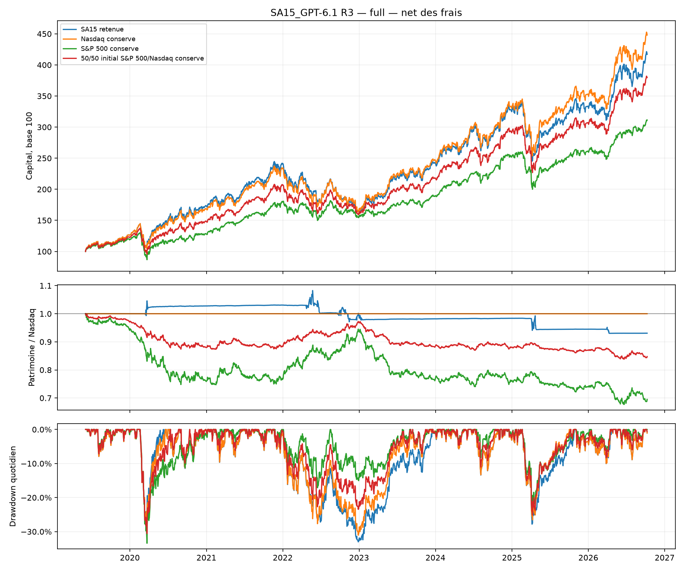
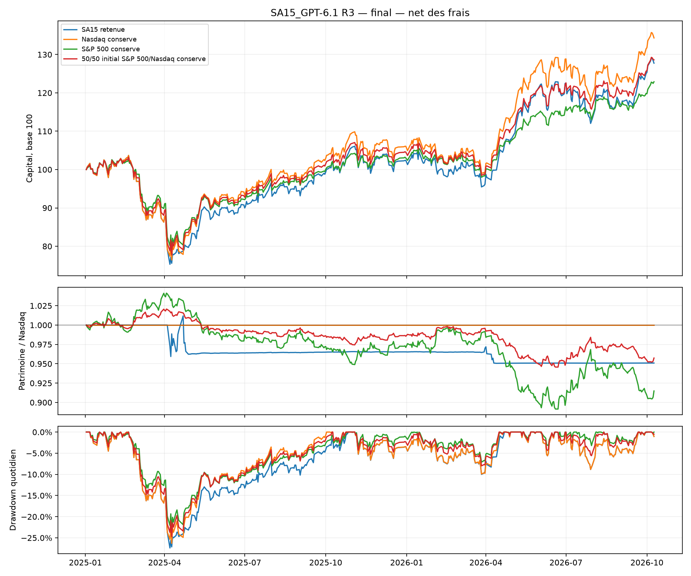

# SA15_GPT-6.1 — troisieme serie — 2026-10-15

Objectif : battre la croissance nette du **Nasdaq 100 achete et conserve**, sans levier.
Statut : **NOT_SUPPORTED**. Configuration gelee : **essai 30** parmi
10 configurations de cette serie, soit **30 designs cumules annonces**.
Motif : pas de surperformance nette du Nasdaq sur l'historique continu; pas de surperformance nette du Nasdaq sur le controle chronologique.

L'ecart de rendement net total au Nasdaq conserve est **-31.04 points**
sur l'historique continu et **-6.59 points** sur le controle chronologique.
Pour 100,000 EUR au depart, l'ecart de capital terminal vaut
respectivement **-31,039 EUR** et **-6,586 EUR**.
Les resultats sont nets des frais simules, avant fiscalite personnelle.
Un meilleur Sharpe ou un drawdown plus faible ne remplace pas cet objectif de croissance.

## Historique continu : 3 juin 2019 au 9 octobre 2026

| Livre | Net total | Brut total | CAGR | Volatilite | Sharpe | Drawdown | Frais EUR |
| --- | --- | --- | --- | --- | --- | --- | --- |
| SA15 retenue | 316.96 % | 320.57 % | 21.44 % | 19.72 % | 1.07 | -33.01 % | 3610 |
| Nasdaq conserve | 348.00 % | 348.10 % | 22.63 % | 20.49 % | 1.08 | -31.05 % | 98 |
| S&P 500 conserve | 211.42 % | 211.52 % | 16.71 % | 16.77 % | 0.99 | -33.42 % | 99 |
| 50/50 initial S&P 500/Nasdaq conserve | 279.70 % | 279.80 % | 19.90 % | 18.44 % | 1.06 | -30.55 % | 98 |

Ce parcours comprend developpement, selection et controle : il decrit le gagnant retrospectif.
Le S&P 500 conserve et le 50/50 initial S&P 500/Nasdaq apportent du contexte.
Le 50/50 derive apres l'achat initial ; il n'est pas reequilibre.

## Controle chronologique : 2 janvier 2025 au 9 octobre 2026

| Livre | Net total | Brut total | CAGR | Volatilite | Sharpe | Drawdown | Frais EUR |
| --- | --- | --- | --- | --- | --- | --- | --- |
| SA15 retenue | 27.74 % | 28.17 % | 14.87 % | 19.05 % | 0.81 | -27.40 % | 434 |
| Nasdaq conserve | 34.32 % | 34.42 % | 18.19 % | 19.72 % | 0.93 | -26.30 % | 98 |
| S&P 500 conserve | 22.89 % | 22.99 % | 12.38 % | 15.38 % | 0.82 | -23.16 % | 99 |
| 50/50 initial S&P 500/Nasdaq conserve | 28.60 % | 28.70 % | 15.31 % | 17.34 % | 0.90 | -24.74 % | 99 |

L'alpha annuel de regression au Nasdaq vaut **-1.66 %**,
avec beta **0.93**.
Le patrimoine relatif termine a **0.9510**
fois celui du Nasdaq. L'alpha, la difference des rendements totaux et le ratio de patrimoines
sont trois mesures distinctes. L'alpha face a un seul indice ne prouve pas une capacite de timing.

## Configuration effectivement retenue

Classe sauvegardee : quant_backtester.strategies.SA15_gpt61_nasdaq.SA15NasdaqAdaptive.
Les valeurs par defaut de la classe sont un prototype ; elles ne remplacent pas la configuration
selectionnee. Le tableau utilise tous les parametres effectifs de strategy.json final,
verifies contre selected.json et l'empreinte **6cb68a453717d5eaf795376c2ff89eb65fd7b880bb791fb307a2c1c7087bea64**.
Le candidat contient seulement les changements demandes, le tableau inclut les champs herites.

| Parametre gele | Valeur effective |
| --- | --- |
| core_id | "ETF_NASDAQ" |
| defensive_ids | ["ETF_GOLD", "ETF_SP500_PEA"] |
| monetary_id | "ETF_MONETARY_EUR" |
| guard_mode | "momentum" |
| trend_sessions | 0 |
| fast_lookback | 10 |
| slow_lookback | 126 |
| fast_entry_threshold | -0.04 |
| slow_entry_threshold | 0.0 |
| recovery_threshold | 0.0 |
| core_floor | 0.5 |
| defensive_lookbacks | [63, 126] |
| defensive_weights | [1.0, 1.0] |
| top_k | 1 |
| switch_buffer | 0.02 |
| rebalance_band | 0.08 |
| relative_rotation | false |
| relative_threshold | 0.02 |
| monetary_lookback | 21 |
| max_age_sessions | 1 |
| strategy_id | "SA15_GPT-6.1_R3" |

La cible normale est **100 % Nasdaq 100**. Le signal rapide est le rendement simple sur **10 seances**. Une crise est ouverte lorsque le rendement de Nasdaq 100 sur 126 seances est inferieur ou egal a 0.00 % **et** que le signal rapide est inferieur ou egal a **-4.00 %**, tout en restant strictement sous le seuil de reprise **0.00 %**. Une position defensive deja detenue reste reconnue tant que le regime est faible et que le signal rapide reste sous **0.00 %**. Le retour au coeur est donc possible avant le retablissement de la tendance lente.

En defense, la cible du coeur devient **50.00 %** ; le budget restant peut etre alloue a **or (ETC Xetra-Gold), S&P 500**. Le score defensif est (1.0 * log(P_t / P_(t-63)) + 1.0 * log(P_t / P_(t-126))) / somme des poids. Jusqu'a **1** lignes de score strictement positif sont retenues. Le budget est partage a parts egales entre les lignes retenues. A defaut, le repli est monetaire EUR seulement si son rendement sur 21 seances est positif ; sinon cash. Hors crise, la rotation relative est desactivee : la cible normale reste le coeur.

Le tampon de remplacement vaut 0.0200 en unites de log-rendement : les lignes admissibles deja detenues proches du score de coupure sont prioritaires. La bande de reequilibrage vaut 8.00 %. Une reprise force le retour complet au coeur lorsque la rotation relative ne retient pas de defense ; la bande ne bloque pas ce retour. Les positions effectivement detenues servent a reconnaitre l'etat defensif : une poche relative peut aussi jouer ce role si le coeur devient faible. Un poids positif du coeur inferieur a (1 + core_floor) / 2 reconnait egalement une defense partiellement restee en cash. Un portefeuille entierement en cash reevalue les conditions d'entree sans memoire. Un signal obligatoire du coeur absent cible le cash ; une defense sans signal est exclue individuellement. Les prix ajustes servent aux signaux ; les ordres, les parts entieres et les frais expliquent les ecarts entre cibles et positions. Aucun levier ni vente a decouvert.

Cadence : **weekly**.
Premiere decision des la premiere seance, puis fins de mois ou de semaine selon la cadence ;
une cadence quotidienne evalue chaque seance.
Decision : **23:00:00, Europe/Paris**, apres les clotures.
Execution : ouverture negociable suivante, instant moteur **09:01:00**.
L'allocation initiale immediate evite une attente mensuelle artificielle face au Nasdaq conserve.
Les signaux de momentum utilisent les endpoints exacts des horizons de seances ajustes.
Un endpoint absent refuse le signal ; les moyennes mobiles requierent les seances consecutives
exactes. Ce rapport ne comble aucun trou de donnees.

## Dix iterations : essais 21 a 30

Les exces sont les differences de CAGR au **Nasdaq conserve** sur les memes dates.
Priorite aux deux exces strictement positifs, puis score decroissant, puis premier numero.
Score = moyenne(exces developpement, exces selection) - 0.25 * ecart absolu des deux exces.
Le rapport lit les calculs sauves ; il ne choisit pas de nouveau gagnant.

| Essai | CAGR dev. | Exces dev. | CAGR selection | Exces selection | Deux positifs | Score | DSR |
| --- | --- | --- | --- | --- | --- | --- | --- |
| 21 | 13.25 % | -1.71 % | 38.26 % | -2.03 % | non | -0.0195 | 0.990 |
| 22 | 15.66 % | 0.70 % | 35.71 % | -4.59 % | non | -0.0327 | 0.986 |
| 23 | 6.02 % | -8.94 % | 21.81 % | -18.48 % | non | -0.1610 | 0.913 |
| 24 | 16.57 % | 1.61 % | 38.36 % | -1.94 % | non | -0.0105 | 0.990 |
| 25 | 14.52 % | -0.44 % | 38.36 % | -1.94 % | non | -0.0156 | 0.990 |
| 26 | 13.66 % | -1.30 % | 40.29 % | 0.00 % | non | -0.0097 | 0.992 |
| 27 | 13.66 % | -1.30 % | 39.79 % | -0.51 % | non | -0.0110 | 0.991 |
| 28 | 10.91 % | -4.05 % | 39.43 % | -0.86 % | non | -0.0326 | 0.990 |
| 29 | 13.54 % | -1.42 % | 40.29 % | 0.00 % | non | -0.0107 | 0.992 |
| 30 | 14.91 % | -0.05 % | 40.29 % | 0.00 % | non | -0.0004 | 0.992 |

21. Nouveau point de départ : 100% Nasdaq par défaut. Ne réduire à50% que si momentum126 non positif et rendement21 inférieur à-4%, avec reprise rapide dès rendement21 non négatif. Poche défensive sur meilleur momentum positif or/S&P500, sinon monétaire positif/cash. Décision mensuelle pour contenir frais et fausses sorties.
22. L'essai21 perd1,71/2,03 points annualisés contre Nasdaq ; la protection2022 commence seulement en mai et les retours août/novembre coûtent de la hausse. Rendre le filtre lent plus réactif :63 séances au lieu de126, sans changer la protection partielle, les seuils ni la cadence.
23. Les protections seules21/22 perdent contre Nasdaq en sélection2023-2024 ; le filtre63 améliore le développement mais accroît les faux changements. Nouvelle hypothèse : autoriser une rotation complète vers le meilleur or/S&P500 positif dépassant le momentum Nasdaq63/126 de2 points logarithmiques. Retour au filtre lent126, même cadence mensuelle ; aucune lecture finale.
24. La rotation relative23 perd8,94/18,48 points annualisés : abandonner ce classement lent hors crise. Reprendre la protection partielle21 mais vérifier chaque semaine, pour mesurer si les sorties/réentrées avant la fin du mois réduisent les reprises manquées. Tous les paramètres de21 sont inchangés.
25. L'hebdomadaire24 gagne1,61 point annualisé en développement, mais perd encore1,94 en sélection, notamment pendant le redémarrage haussier de début2023. Réserver la protection aux crises plus profondes : rendement126 au plus-10%, au lieu de toute valeur négative ; conserver rythme et protection50% de24.
26. Le seuil de crise-10% de25 dégrade le développement sans améliorer la sélection : revenir au meilleur filtre hebdomadaire24. Les fenêtres21 séances retardent encore la reprise ; tester un horizon rapide de5 séances pour entrée/reprise, sans changer filtre lent126, seuil de choc-4%, ni poche défensive50%.
27. Le retour5séances de26 égale Nasdaq en sélection mais les allers-retours2022 dégradent le développement. Tester une mesure de régime différente, prix sous MA200, au lieu du rendement126 non positif. Conserver seuil rapide5séances-4%, retour0%, protection50% et cadence hebdomadaire, sans rotation relative.
28. MA200 hebdomadaire27 reste inférieur au Nasdaq ; les transactions de26 montrent plusieurs ventes après la chute puis rachats après un rebond hebdomadaire de5 à6%. Garder exactement la politique27 et évaluer chaque soir pour tester si une réaction plus rapide compense les frais et interventions supplémentaires.
29. Le quotidien28 accroît les faux changements et les coûts : revenir à26, meilleur score parmi21–28, qui égale Nasdaq en sélection. En développement, les poches or de mai/juin2022 baissent pendant des rebonds Nasdaq. Remplacer le satellite S&P500 par les matières premières pour tester une défense plus adaptée aux régimes inflationnistes, sans toucher aux seuils, rythme hebdomadaire ni protection50%.
30. Les matières premières29 ne sauvent pas le développement ; reprendre26, meilleur score actuel. Dernier voisin : horizon rapide10 séances, entre5 (retours trop fréquents dans les rebonds2022) et21 (reprise trop tardive). Conserver exactement filtre lent126, seuils-4%/0%, poche50% or/S&P500 et cadence hebdomadaire. Aucune nouvelle variante après ce dixième design.

Developpement : 2019-06-03/2022-12-30. Selection : 2023-01-02/2024-12-31.
Le [protocole R3](../../research/SA15_GPT-6.1/round3/protocol.md) fixe ces conditions.
Toute l'histoire 2019-2026 avait deja ete examinee : aucune de ces periodes n'est un echantillon
vierge. Le controle final est retrospectif. Les calculs et archives des deux series precedentes
restent conserves.

Le DSR annonce **30 essais correles**, avec dispersion estimee sur
**30 courbes** de selection
(source : R1_R2_R3_validation_curves ; ecart-type des Sharpe par seance :
0.012235).
Anciens essais manquants : [].
Chaque courbe R1/R2 disponible est utilisee ; une absence ne ramene jamais le nombre annonce
sous 30. Le DSR reste un diagnostic sans seuil supplementaire et ne corrige pas tous les choix
historiques du projet, dont l'univers et le changement successif des references.

## Interventions, frais et positions

| Periode | Jours d'ordres/an | Ordres/an | Rotation/an | Frais EUR | Nasdaq 100 moyen | Defense hors monetaire | Monetaire moyen | Cash moyen |
| --- | --- | --- | --- | --- | --- | --- | --- | --- |
| Historique continu | 2.72 | 5.17 | 2.13 | 3610 | 96.21 % | 2.14 % | 1.17 % | 0.49 % |
| Controle chronologique | 2.83 | 5.10 | 2.40 | 434 | 96.82 % | 2.26 % | 0.00 % | 0.93 % |

Un jour d'ordres est une date de fills distincte ; plusieurs transactions le meme jour
restent plusieurs ordres. L'entree initiale est incluse.
L'annualisation utilise le temps calendaire ecoule.
Les references sans details n'ont pas de dates d'ordres reconstituees.
Sur l'historique continu : **20 dates d'ordres
en 7.35 ans**. Sur le controle : **5
dates en 1.77 ans**.
La cadence demande environ **52 evaluations par an**,
plus la premiere decision, meme lorsqu'aucun ordre n'est necessaire.

Poids reellement detenus, moyens sur toutes les seances, y compris l'attente du premier achat :

| Periode | Position | Identifiant | Poids moyen |
| --- | --- | --- | --- |
| Historique continu | or (ETC Xetra-Gold) | ETF_GOLD | 2.01 % |
| Historique continu | monetaire EUR | ETF_MONETARY_EUR | 1.17 % |
| Historique continu | Nasdaq 100 | ETF_NASDAQ | 96.21 % |
| Historique continu | S&P 500 | ETF_SP500_PEA | 0.13 % |
| Controle chronologique | or (ETC Xetra-Gold) | ETF_GOLD | 2.26 % |
| Controle chronologique | Nasdaq 100 | ETF_NASDAQ | 96.82 % |

Les fractions moyennes ne sont pas des mesures de beta. Le cash residuel peut venir des parts
entieres et des frais ; une poche de cash tactique depend des signaux effectivement disponibles.

## Lecture des transactions et des rebonds

Continu2019-06-03/2026-10-09 : gain net316,96% contre348,00% Nasdaq ; CAGR21,44% contre22,63% ; drawdown-33,01% contre-31,05%. Le gagnant compte20 dates de transactions (38fills) et3610,33EUR de frais contre un achat/97,82EUR pour Nasdaq.

Final2025-01-02/2026-10-09 : gain net27,74% contre34,32% ; drawdown-27,40% contre-26,30%. Les deux détours vers l'or manquent des rebonds Nasdaq :07/04→28/04/2025, Nasdaq+14,23% contre or+5,49% ;30/03→13/04/2026, Nasdaq+5,96% contre or+3,05%. Le coût des allers-retours s'ajoute à la reprise manquée.

Verdict : NOT_SUPPORTED. Ni rendement supérieur ni baisse maximale améliorée sur les deux contrôles. Les faibles différences entre horizons ne justifient pas d'adopter cette variante. Les courbes et le manifeste de rendu sont produits depuis les résultats archivés ; aucune retouche de stratégie après le contrôle final.
Les figures continues et finales sont inspectées visuellement ; axes, base100, patrimoine relatif Nasdaq et drawdown concordent avec les exports. L'audit final confirme les110 fichiers financiers gelés, les dix designs et le checksum de selected.json.

Source : [verification economique archivee](validation.md).

## Couts, incertitude et sensibilite

Aux frais doubles, le gagnant donne un rendement final net de **27.29 %**,
CAGR **14.64 %**, drawdown **-27.49 %** et
**866 EUR** de frais.
L'ecart au Nasdaq aux frais standards devient **-7.04 points**.
Ce test conservateur ne reestime aucun seuil ni aucun gagnant.

Bootstrap apparie du rendement actif moyen annualise final contre Nasdaq :
**-2.93 %**,
intervalle 95 % **[-7.65 % ; 0.19 %]**.
Blocs circulaires de 20 seances, 2000 tirages, seed 61153.
Ce n'est ni un intervalle de CAGR ni une preuve independante : les periodes ont deja servi
aux recherches, et cet intervalle ne corrige pas les trente essais.

SUPPORTED_RETROSPECTIVE demande une surperformance nette sur continu ET controle,
un avantage persistant aux frais doubles et une borne bootstrap positive.
Un echec de croissance sur continu ou controle vaut NOT_SUPPORTED ;
un doute lie aux frais ou a l'intervalle vaut UNCERTAIN lorsque les deux exces sont positifs.
Aucun de ces statuts ne garantit une performance future.

[Frais doubles des configurations](robustness/costs_x2.csv) —
[Redemarrages depuis cash](robustness/starts.csv) —
[Diagnostic continu](robustness/full.csv).

## Rendements annuels de l'historique continu

| Annee | SA15 | Nasdaq | S&P 500 | 50/50 initial |
| --- | --- | --- | --- | --- |
| 2019 | 26.10 % | 26.10 % | 18.62 % | 22.36 % |
| 2020 | 37.62 % | 33.90 % | 8.01 % | 21.35 % |
| 2021 | 39.27 % | 38.85 % | 40.16 % | 39.41 % |
| 2022 | -32.00 % | -29.78 % | -14.04 % | -22.96 % |
| 2023 | 48.04 % | 50.53 % | 22.24 % | 36.84 % |
| 2024 | 33.52 % | 33.26 % | 33.54 % | 33.38 % |
| 2025 | 2.72 % | 6.93 % | 3.57 % | 5.48 % |
| 2026 | 24.95 % | 26.86 % | 19.34 % | 23.67 % |

La premiere et la derniere annee sont partielles. Les drawdowns sont quotidiens meme avec
decisions mensuelles. Chaque run commence en cash et n'herite pas des positions d'un autre run.
Le continu porte ensuite ses positions entre les annees : une egalite avec Nasdaq dans
la selection redemarree depuis cash ne signifie pas une egalite sur ces memes annees
du continu. Le garde-fou utilise le portefeuille effectivement detenu.

## Limites et sources

La concentration du Nasdaq peut dominer une allocation defensive pendant une longue hausse.
Sortir apres une baisse puis revenir apres un rebond consomme du capital et des frais.
Une rotation vers l'or peut profiter d'un regime particulier sans prouver un avantage durable.
L'or n'est pas un refuge garanti ; Xetra-Gold est un ETC et non un ETF UCITS.
Le petit univers de fonds encore disponibles a ete choisi retrospectivement.
Les cotations en EUR ne suppriment pas les risques de devises sous-jacents.
Les prix ajustes telecharges aujourd'hui peuvent etre revises ; ce ne sont pas des archives
de cours disponibles a chaque date historique. Le Sharpe utilise un taux sans risque nul.
Les trous et refus de signaux restent documentes dans les calculs sauvegardes.

Voir la [revue de litterature R3](../../research/SA15_GPT-6.1/round3/literature.md) :
[Clare et al., tendance et frequence](https://pure.york.ac.uk/portal/en/publications/breaking-into-the-blackbox-trend-following-stop-losses-and-the-fr/),
[Faber, allocation tactique](https://papers.ssrn.com/sol3/Papers.cfm?abstract_id=962461),
[Levine et Pedersen, filtres et couts](https://www.aqr.com/Insights/Research/Journal-Article/Which-Trend-Is-Your-Friend),
[Baur et Lucey, or et refuge](https://onlinelibrary.wiley.com/doi/10.1111/j.1540-6288.2010.00244.x),
[forum sur les faux signaux et rebonds](https://www.reddit.com/r/TQQQ/comments/1q2nr5z/9sig_vs_dca_vs_200sma_one_shot_strategy_backtest/).
Ces sources motivent des hypotheses ; aucun de leurs rendements n'est attribue a SA15 R3.
Le forum fournit des objections pratiques, pas une validation scientifique.

## Reproduction

Depuis WSL/POSIX, dans un NOUVEAU dossier et avec le magasin isole deja valide :

    OUT=runs/sa15_r3_reproduction
    CANDIDATES=research/SA15_GPT-6.1/round3/candidates
    for N in $(seq 21 30); do
        SPEC=$(printf "%s/trial_%02d.json" "$CANDIDATES" "$N")
        uv run python scripts/SA15_run_gpt61_round3.py --candidate "$SPEC" --output "$OUT"
    done
    uv run python scripts/SA15_run_gpt61_round3.py --final --output "$OUT"
    uv run python scripts/SA15_run_gpt61_round3.py --robustness --output "$OUT" --workers 2
    uv run python scripts/SA15_report_gpt61_round3.py --output "$OUT"

Pour regenerer les exports seuls, sans nouveau backtest :

    uv run python scripts/SA15_report_gpt61_round3.py --output results/SA15_GPT-6.1_R3

Ce rapport ne modifie aucun candidat, aucune selection, aucun ordre ni aucune archive
financiere. reporting_manifest.json date le rendu et donne l'empreinte du source de rapport,
distinct du source financier archive avant les diagnostics.

[Tableau complet](comparison/full/summary.csv) — [Tableau final](comparison/final/summary.csv) —
[Courbes sauvegardees](comparison/full/equity.csv) — [Iterations](reported_iterations.csv) —
[Selection gelee](selected.json) — [Diagnostic DSR](selection_diagnostics.json) —
[Verdict machine](verdict.json).

[Verification et limites](validation.md).
