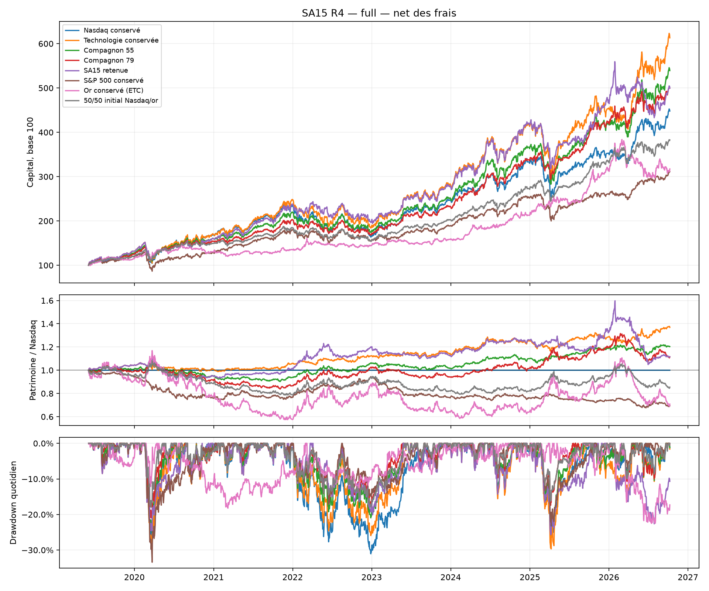
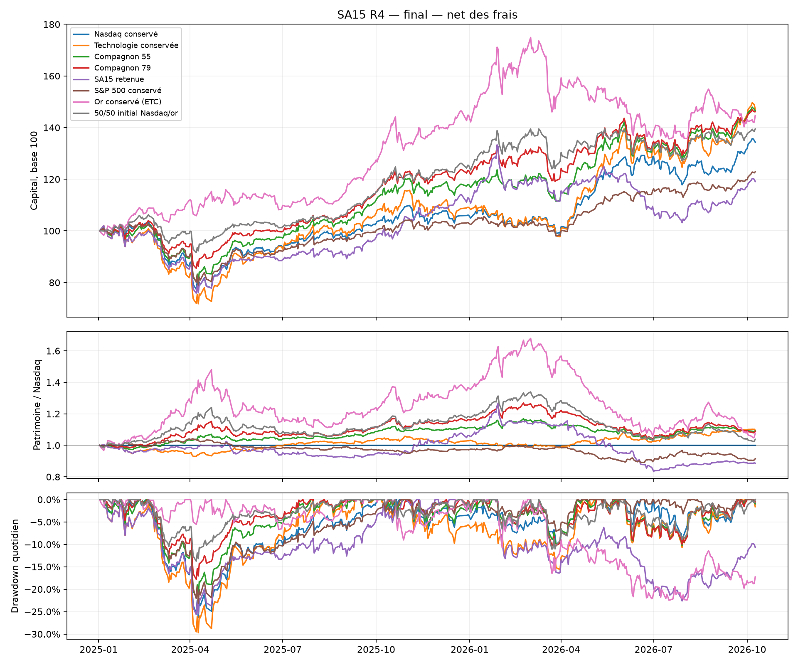
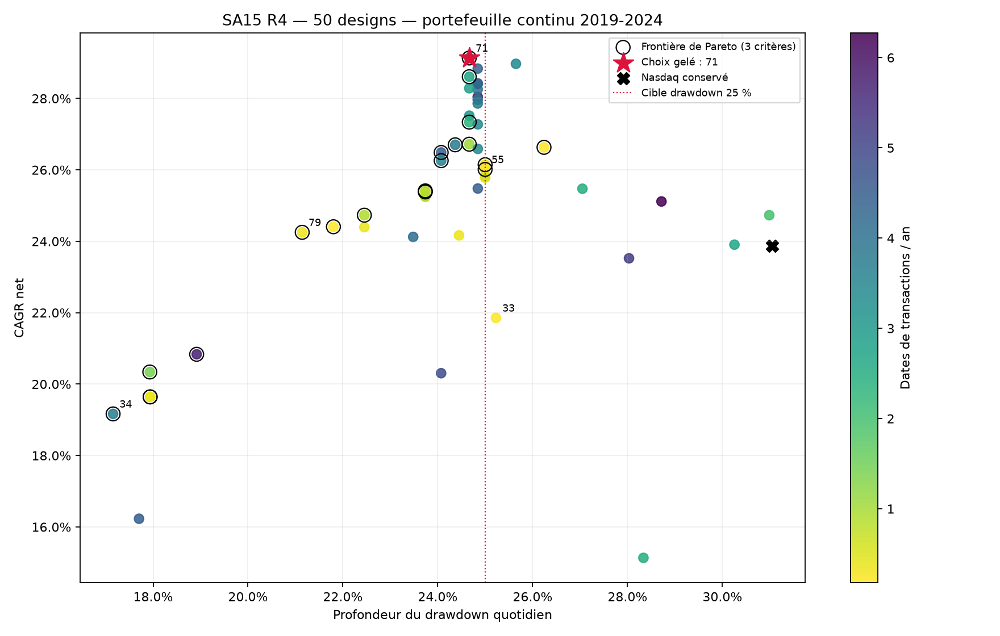

# SA15_GPT-6.1 — cinquante itérations supplémentaires — 16 octobre 2026

Objectif : battre Nasdaq acheté puis conservé, en favorisant **drawdown ≤25 %** et **au plus
quatre dates de transactions par an**.
Statut : **NOT_SUPPORTED**. Choix gelé : **essai 71**, parmi **50 nouveaux designs, 80 cumulés**.
Motif : pas de surperformance nette du Nasdaq sur contrôle chronologique

L'écart net au Nasdaq vaut **51.69 pp** sur le continu et
**-15.24 pp** sur le contrôle chronologique.
Les rendements sont en EUR, nets des frais simulés, avant fiscalité personnelle.
Toute l'histoire était déjà connue : cette recherche est rétrospective.

## Historique continu — 3 juin 2019 au 9 octobre 2026

| Livre | Net total | Brut total | CAGR | Volatilite | Sharpe | Drawdown | Frais EUR |
| --- | --- | --- | --- | --- | --- | --- | --- |
| Nasdaq conservé | 348.00 % | 348.10 % | 22.63 % | 20.49 % | 1.08 | -31.05 % | 98 |
| Technologie conservée | 513.08 % | 513.18 % | 27.98 % | 23.10 % | 1.17 | -30.99 % | 98 |
| Compagnon 55 | 439.19 % | 439.29 % | 25.76 % | 18.98 % | 1.28 | -25.00 % | 98 |
| Compagnon 79 | 399.83 % | 400.02 % | 24.47 % | 16.15 % | 1.41 | -21.14 % | 190 |
| SA15 retenue | 399.69 % | 406.65 % | 24.46 % | 19.66 % | 1.19 | -25.68 % | 6961 |
| S&P 500 conservé | 211.42 % | 211.52 % | 16.71 % | 16.77 % | 0.99 | -33.42 % | 99 |
| Or conservé (ETC) | 217.42 % | 217.52 % | 17.01 % | 16.19 % | 1.03 | -22.49 % | 100 |
| 50/50 initial Nasdaq/or | 282.80 % | 282.89 % | 20.03 % | 13.87 % | 1.36 | -18.00 % | 99 |

Le contrôle technologie conservée montre si une meilleure composition explique l'avantage. Or =
ETC Xetra-Gold, pas ETF UCITS.
Le 50/50 Nasdaq/or est acheté à parts égales puis laissé dériver ; aucun rééquilibrage après
l'entrée.
Le meilleur rendement ou la plus faible baisse des contrôles ne remplace pas le gagnant gelé.

## Contrôle chronologique — 2 janvier 2025 au 9 octobre 2026

| Livre | Net total | Brut total | CAGR | Volatilite | Sharpe | Drawdown | Frais EUR |
| --- | --- | --- | --- | --- | --- | --- | --- |
| Nasdaq conservé | 34.32 % | 34.42 % | 18.19 % | 19.72 % | 0.93 | -26.30 % | 98 |
| Technologie conservée | 47.18 % | 47.28 % | 24.47 % | 24.54 % | 1.00 | -29.69 % | 99 |
| Compagnon 55 | 46.53 % | 46.63 % | 24.16 % | 19.01 % | 1.22 | -21.79 % | 99 |
| Compagnon 79 | 46.16 % | 46.26 % | 23.98 % | 17.45 % | 1.30 | -17.79 % | 99 |
| SA15 retenue | 19.09 % | 20.40 % | 10.40 % | 20.55 % | 0.58 | -25.65 % | 1312 |
| S&P 500 conservé | 22.89 % | 22.99 % | 12.38 % | 15.38 % | 0.82 | -23.16 % | 99 |
| Or conservé (ETC) | 44.72 % | 44.82 % | 23.28 % | 21.77 % | 1.06 | -22.43 % | 99 |
| 50/50 initial Nasdaq/or | 39.50 % | 39.60 % | 20.75 % | 16.00 % | 1.24 | -13.75 % | 99 |

Sur le contrôle chronologique 2025-2026, alpha annuel de régression au Nasdaq :
-1.19 % ;
bêta : 0.71.
L'alpha face à un indice ne démontre pas une capacité de timing.

## Choix continu — juin 2019 à décembre 2024

| Livre | Net total | Brut total | CAGR | Volatilite | Sharpe | Drawdown | Frais EUR |
| --- | --- | --- | --- | --- | --- | --- | --- |
| SA15 retenue | 316.46 % | 318.31 % | 29.13 % | 19.37 % | 1.39 | -24.66 % | 1851 |
| Nasdaq conservé | 230.24 % | 230.34 % | 23.88 % | 20.68 % | 1.12 | -31.05 % | 98 |
| S&P 500 conservé | 151.96 % | 152.06 % | 18.01 % | 17.19 % | 1.03 | -33.42 % | 99 |
| Or conservé (ETC) | 112.67 % | 112.77 % | 14.48 % | 13.89 % | 1.03 | -18.22 % | 100 |
| 50/50 initial Nasdaq/or | 171.50 % | 171.60 % | 19.60 % | 13.20 % | 1.40 | -18.00 % | 99 |
| Technologie conservée | 313.53 % | 313.63 % | 28.97 % | 22.64 % | 1.22 | -30.99 % | 98 |

Un vrai portefeuille continu, sans reset en 2023. Le segment 2023-2024 conserve les positions et
coûts ; la dernière clôture 2022 ancre son premier rendement.
Le contrôle 2025-2026 et le parcours complet ont été exécutés après gel du gagnant. Ils ne
modifient pas son classement.

Le brut conserve les mêmes transactions en retirant les frais ; il ne recalcule pas
un portefeuille contrefactuel sans frais. Une tranche 2023-2024 possède des ancres brut/net
différentes à cause des coûts antérieurs ; son rendement brut normalisé peut donc être
légèrement inférieur au net sans frais dans cette tranche.

| Lecture du choix | Essai | CAGR net | Drawdown | Dates/an | Qualifié |
| --- | --- | --- | --- | --- | --- |
| Choix gelé | 71 | 29.13 % | -24.66 % | 3.41 | oui |
| Meilleur rendement | 71 | 29.13 % | -24.66 % | 3.41 | oui |
| Plus faible drawdown | 34 | 19.17 % | -17.16 % | 3.76 | non |
| Moins de dates d'ordres | 43 | 26.63 % | -26.24 % | 0.18 | non |

Les lignes ci-dessus décrivent des compromis de choix et ne remplacent jamais l'essai 71.
Frontière de Pareto : 31, 32, 34, 35, 43, 48, 49, 51, 52, 55, 56, 60, 68, 70, 71, 73, 75, 78, 79, 80. Dominance simultanée en CAGR, drawdown et
dates de transactions.

## Compagnons descriptifs gelés avant contrôle

Ces portefeuilles décrivent les extrema risque/interventions parmi les candidats qualifiés sur le choix 2019-2024. Ils ont été gelés indépendamment avant les contrôles, ne remplacent jamais le gagnant et ne modifient pas son verdict. Leurs replays ne sont pas de nouveaux designs. Les critères anglais signifient minimum_interventions = moins de dates de fills ; minimum_drawdown = moindre baisse.

| Essai | Critère gelé | Période | Net x1 | Écart Nasdaq | DD x1 | Dates/an | Net x2 | Écart x2 | DD x2 |
| --- | --- | --- | --- | --- | --- | --- | --- | --- | --- |
| 55 | minimum_interventions | full | 439.19 % | 91.19 pp | -25.00 % | 0.14 | 438.93 % | 90.93 pp | -25.01 % |
| 55 | minimum_interventions | final | 46.53 % | 12.21 pp | -21.79 % | 0.57 | 46.42 % | 12.09 pp | -21.80 % |
| 79 | minimum_drawdown | full | 399.83 % | 51.83 pp | -21.14 % | 0.27 | 399.40 % | 51.40 pp | -21.15 % |
| 79 | minimum_drawdown | final | 46.16 % | 11.84 pp | -17.79 % | 0.57 | 46.06 % | 11.74 pp | -17.81 % |

Essai 55, cadence quarterly, Mode **balanced**. Le bloc offensif détient les lignes disponibles sans filtre de signe du momentum. Cœur : Technologie américaine. Univers offensif : Technologie américaine, Or (ETC Xetra-Gold). Allocation : fixed. Poids fixes alignés sur cet univers : [0.75, 0.25]. Horizons : [21, 63, 126] ; poids : [1.0, 1.0, 1.0]. Le nombre et les poids réellement détenus sont publiés plus bas. Défense : aucune ligne classée, jusqu'à 1 lignes de momentum positif ; repli monétaire si le rendement déclaré est positif, sinon cash. Les 2 lignes offensives configurées sont détenues si disponibles ; top_k et core_floor ne pilotent pas ce mode. Dans cette configuration, horizons de classement, votes, bonus de maintien et défense classée sont inactifs ; la cible de volatilité nulle désactive aussi le contrôle de risque. Les poids fixes et la bande de dérive pilotent les transactions. Bande de rééquilibrage 15.00 %, bonus de maintien 0.02. Les lignes absentes sont exclues selon les contrats de signaux, sans imputation. Aucun modèle ajusté, short ou levier.

Essai 55 : une seule date de transactions sur le continu, l'achat initial. Le résultat équivaut donc à conserver l'allocation achetée ; ce n'est pas un alpha de rotation active.

Essai 55 : le drawdown normal vaut -24.99864 %, contre -25.00808 % aux frais doubles. La borne historique de 25 % est donc fragile et franchie strictement sous ce stress, même si l'avantage de rendement demeure.

Essai 79, cadence quarterly, Mode **balanced**. Le bloc offensif détient les lignes disponibles sans filtre de signe du momentum. Cœur : Technologie américaine. Univers offensif : Technologie américaine, Or (ETC Xetra-Gold). Allocation : fixed. Poids fixes alignés sur cet univers : [0.6, 0.4]. Horizons : [21, 63, 126] ; poids : [1.0, 1.0, 1.0]. Le nombre et les poids réellement détenus sont publiés plus bas. Défense : aucune ligne classée, jusqu'à 1 lignes de momentum positif ; repli monétaire si le rendement déclaré est positif, sinon cash. Les 2 lignes offensives configurées sont détenues si disponibles ; top_k et core_floor ne pilotent pas ce mode. Dans cette configuration, horizons de classement, votes, bonus de maintien et défense classée sont inactifs ; la cible de volatilité nulle désactive aussi le contrôle de risque. Les poids fixes et la bande de dérive pilotent les transactions. Bande de rééquilibrage 15.00 %, bonus de maintien 0.02. Les lignes absentes sont exclues selon les contrats de signaux, sans imputation. Aucun modèle ajusté, short ou levier.

## Configuration effectivement retenue

Classe sauvegardée : quant_backtester.strategies.SA15_gpt61_riskaware.SA15RiskAwareRotation. Empreinte : ef95006960c2102347cd008e43ee2959526e576f4971ceca75b3fdb398cbe69e.
Les valeurs par défaut de la classe ne sont pas utilisées pour ce récit : les paramètres complets
ci-dessous sont vérifiés contre selected.json, candidate.json et strategy.json.

Mode **vol_control**. Le bloc offensif part du cœur puis réduit son poids selon le plafond de risque estimé. Cœur : Technologie américaine. Univers offensif : Technologie américaine. Allocation : equal. Horizons : [21, 63, 126] ; poids : [1.0, 1.0, 1.0]. Le nombre et les poids réellement détenus sont publiés plus bas. Défense : Or (ETC Xetra-Gold), Matières premières, jusqu'à 1 lignes de momentum positif ; repli monétaire si le rendement déclaré est positif, sinon cash. Plafond de risque du bloc offensif 20.00 %, fenêtres [20, 60]. L'estimation somme poids x maximum des volatilités historiques ; elle exclut la défense et n'est pas une cible de volatilité totale. Bande de rééquilibrage 20.00 %, bonus de maintien 0.02. Les lignes absentes sont exclues selon les contrats de signaux, sans imputation. Aucun modèle ajusté, short ou levier.

| Paramètre gelé | Valeur effective |
| --- | --- |
| core_id | "ETF_US_TECH" |
| risky_ids | ["ETF_US_TECH"] |
| defensive_ids | ["ETF_GOLD", "ETF_COMMODITY"] |
| monetary_id | "ETF_MONETARY_EUR" |
| mode | "vol_control" |
| momentum_lookbacks | [21, 63, 126] |
| momentum_weights | [1.0, 1.0, 1.0] |
| trend_kind | "momentum" |
| core_floor | 0.0 |
| top_k | 1 |
| allocation_mode | "equal" |
| fixed_weights | [] |
| absolute_filter | true |
| core_preference | 0.02 |
| switch_buffer | 0.02 |
| rebalance_band | 0.2 |
| canary_ids | [] |
| canary_lookbacks | [21, 63, 126] |
| canary_weights | [1.0, 1.0, 1.0] |
| canary_min_breadth | 0.5 |
| volatility_windows | [20, 60] |
| volatility_floor | 0.05 |
| target_volatility | 0.2 |
| recovery_lookback | 0 |
| recovery_threshold | 0.0 |
| defensive_top_k | 1 |
| monetary_lookback | 21 |
| max_age_sessions | 1 |
| strategy_id | "SA15_GPT-6.1_R4" |

Cadence : **monthly**, première décision dès la première séance.
Décision 23:00:00
Europe/Paris, après clôtures ; exécution
09:01:00 à l'ouverture négociable suivante.
Les signaux lisent les endpoints exacts de leur calendrier ; moyenne mobile et volatilité
demandent les séances consécutives déclarées. Aucun remplissage.

## Les cinquante essais — 31 à 80

Priorité : qualification (excès CAGR positif, DD ≤25 %, dates/an ≤4), puis score, puis premier
numéro.
Score = excès CAGR choix +0,20x(DD Nasdaq-DD candidat) -0,50xmax(0,DD-0,25)
-0,001xmax(0,dates/an-4) -0,25xmax(0,-excès CAGR 2023-24).
Les DD de cette formule sont des profondeurs positives. Le rapport lit les scores archivés, sans
sélectionner un nouveau gagnant.

| Essai | Mode | Cadence | CAGR choix | Excès Nasdaq | DD | Dates/an | Excès 2023-24 | Qualifié | Score | DSR |
| --- | --- | --- | --- | --- | --- | --- | --- | --- | --- | --- |
| 31 | balanced | monthly | 19.64 % | -4.23 pp | -17.94 % | 0.36 | -11.14 pp | non | -0.0439 | 0.996 |
| 32 | balanced | quarterly | 19.64 % | -4.23 pp | -17.94 % | 0.36 | -11.14 pp | non | -0.0439 | 0.996 |
| 33 | balanced | quarterly | 21.85 % | -2.02 pp | -25.23 % | 0.18 | -4.29 pp | non | -0.0204 | 0.990 |
| 34 | balanced | monthly | 19.17 % | -4.71 pp | -17.16 % | 3.76 | -9.54 pp | non | -0.0432 | 0.997 |
| 35 | balanced | quarterly | 26.15 % | 2.27 pp | -25.00 % | 0.36 | 2.96 pp | oui | 0.0348 | 0.991 |
| 36 | rotate | monthly | 20.31 % | -3.57 pp | -24.07 % | 4.84 | -7.66 pp | non | -0.0417 | 0.959 |
| 37 | rotate | monthly | 15.13 % | -8.74 pp | -28.34 % | 2.51 | -9.95 pp | non | -0.1235 | 0.904 |
| 38 | ensemble | monthly | 23.91 % | 0.03 pp | -30.25 % | 2.69 | -3.80 pp | non | -0.0339 | 0.972 |
| 39 | vol_control | monthly | 28.05 % | 4.17 pp | -24.84 % | 5.74 | 4.14 pp | non | 0.0524 | 0.981 |
| 40 | rotate | monthly | 16.23 % | -7.65 pp | -17.70 % | 4.48 | -10.62 pp | non | -0.0768 | 0.962 |
| 41 | balanced | quarterly | 25.25 % | 1.37 pp | -23.74 % | 0.36 | -1.81 pp | oui | 0.0238 | 0.992 |
| 42 | balanced | quarterly | 24.40 % | 0.52 pp | -22.45 % | 0.36 | -2.48 pp | oui | 0.0162 | 0.993 |
| 43 | balanced | quarterly | 26.63 % | 2.76 pp | -26.24 % | 0.18 | 3.68 pp | non | 0.0310 | 0.986 |
| 44 | balanced | monthly | 25.25 % | 1.38 pp | -23.74 % | 0.36 | -1.68 pp | oui | 0.0242 | 0.992 |
| 45 | vol_control | quarterly | 24.73 % | 0.86 pp | -30.99 % | 1.97 | 2.06 pp | non | -0.0213 | 0.972 |
| 46 | vol_control | monthly | 27.96 % | 4.09 pp | -24.84 % | 3.94 | 4.64 pp | oui | 0.0533 | 0.981 |
| 47 | vol_control | monthly | 27.52 % | 3.64 pp | -24.66 % | 3.05 | 4.20 pp | oui | 0.0492 | 0.981 |
| 48 | vol_control | monthly | 27.34 % | 3.46 pp | -24.66 % | 2.33 | 2.50 pp | oui | 0.0474 | 0.971 |
| 49 | vol_control | monthly | 26.49 % | 2.61 pp | -24.07 % | 4.48 | 1.44 pp | non | 0.0396 | 0.984 |
| 50 | vol_control | monthly | 28.97 % | 5.10 pp | -25.65 % | 3.41 | 5.79 pp | non | 0.0585 | 0.978 |
| 51 | vol_control | monthly | 26.72 % | 2.84 pp | -24.66 % | 1.08 | -1.90 pp | oui | 0.0365 | 0.976 |
| 52 | vol_control | monthly | 26.26 % | 2.38 pp | -24.07 % | 3.58 | 1.44 pp | oui | 0.0378 | 0.984 |
| 53 | vol_control | monthly | 24.12 % | 0.25 pp | -23.48 % | 4.12 | -1.31 pp | non | 0.0142 | 0.986 |
| 54 | vol_control | monthly | 27.28 % | 3.40 pp | -24.84 % | 3.41 | 4.20 pp | oui | 0.0464 | 0.981 |
| 55 | balanced | quarterly | 26.01 % | 2.14 pp | -25.00 % | 0.18 | 2.54 pp | oui | 0.0335 | 0.987 |
| 56 | balanced | quarterly | 25.38 % | 1.51 pp | -23.74 % | 0.18 | 1.36 pp | oui | 0.0297 | 0.989 |
| 57 | balanced | quarterly | 24.17 % | 0.29 pp | -24.45 % | 0.36 | -4.91 pp | oui | 0.0038 | 0.990 |
| 58 | ensemble | monthly | 25.12 % | 1.24 pp | -28.72 % | 6.27 | 2.98 pp | non | -0.0038 | 0.977 |
| 59 | ensemble | monthly | 23.52 % | -0.35 pp | -28.03 % | 5.20 | 0.19 pp | non | -0.0138 | 0.968 |
| 60 | ensemble | monthly | 20.84 % | -3.04 pp | -18.92 % | 5.74 | -12.23 pp | non | -0.0385 | 0.920 |
| 61 | vol_control | monthly | 28.26 % | 4.38 pp | -24.84 % | 3.94 | 4.64 pp | oui | 0.0562 | 0.981 |
| 62 | vol_control | monthly | 28.84 % | 4.96 pp | -24.84 % | 4.30 | 3.77 pp | non | 0.0617 | 0.977 |
| 63 | vol_control | monthly | 28.40 % | 4.53 pp | -24.84 % | 3.94 | 6.04 pp | oui | 0.0577 | 0.983 |
| 64 | vol_control | monthly | 27.86 % | 3.98 pp | -24.84 % | 3.76 | 4.44 pp | oui | 0.0523 | 0.982 |
| 65 | vol_control | monthly | 26.59 % | 2.71 pp | -24.84 % | 3.41 | 1.86 pp | oui | 0.0395 | 0.976 |
| 66 | vol_control | monthly | 28.42 % | 4.55 pp | -24.84 % | 4.30 | 5.73 pp | non | 0.0576 | 0.982 |
| 67 | vol_control | monthly | 25.47 % | 1.60 pp | -27.05 % | 2.51 | 1.15 pp | non | 0.0137 | 0.972 |
| 68 | vol_control | monthly | 26.70 % | 2.83 pp | -24.37 % | 3.76 | 1.42 pp | oui | 0.0416 | 0.976 |
| 69 | balanced | quarterly | 25.82 % | 1.95 pp | -25.00 % | 0.54 | 1.24 pp | oui | 0.0316 | 0.991 |
| 70 | balanced | quarterly | 25.41 % | 1.54 pp | -23.74 % | 0.90 | -0.23 pp | oui | 0.0294 | 0.993 |
| 71 | vol_control | monthly | 29.13 % | 5.26 pp | -24.66 % | 3.41 | 3.66 pp | oui | 0.0654 | 0.977 |
| 72 | vol_control | monthly | 28.29 % | 4.41 pp | -24.66 % | 2.87 | 6.66 pp | oui | 0.0569 | 0.985 |
| 73 | vol_control | monthly | 28.61 % | 4.73 pp | -24.66 % | 2.69 | 6.39 pp | oui | 0.0601 | 0.984 |
| 74 | vol_control | weekly | 25.48 % | 1.60 pp | -24.84 % | 4.48 | 2.65 pp | non | 0.0280 | 0.972 |
| 75 | balanced | quarterly | 24.73 % | 0.86 pp | -22.45 % | 0.90 | -1.66 pp | oui | 0.0216 | 0.994 |
| 76 | balanced | monthly | 25.78 % | 1.91 pp | -25.00 % | 0.54 | 1.26 pp | oui | 0.0312 | 0.992 |
| 77 | balanced | monthly | 25.25 % | 1.38 pp | -23.74 % | 0.90 | -0.17 pp | oui | 0.0280 | 0.993 |
| 78 | balanced | quarterly | 20.34 % | -3.54 pp | -17.93 % | 1.43 | -9.29 pp | non | -0.0323 | 0.996 |
| 79 | balanced | quarterly | 24.25 % | 0.38 pp | -21.14 % | 0.36 | -0.55 pp | oui | 0.0222 | 0.995 |
| 80 | balanced | quarterly | 24.41 % | 0.53 pp | -21.80 % | 0.18 | -0.48 pp | oui | 0.0226 | 0.991 |

31. Point de départ sans signal directionnel : rééquilibrer50% Nasdaq/50% or mensuellement, bande10points, pour chercher une prime de rééquilibrage et une baisse maximale réduite sans retard de réentrée.
32. Même mélange50/50 que31, mais vérification trimestrielle : isoler la réduction du travail et des frais, sans changer univers, poids ou bande.
33. Nasdaq/or75/25 trimestriel, bande10points : préserver davantage de croissance Nasdaq tout en gardant une poche décorrélée et peu de rééquilibrages.
34. Nasdaq/or investi en permanence avec poids inverses au maximum des volatilités20/60séances ; décisions mensuelles et bande10points. Comparer un budget de risque estimé à une simple part fixe, sans cible de volatilité ni levier.
35. TechnologieUS/or75/25 trimestriel, bande10points : tester une source de croissance sectorielle avec défense diversifiante, en comparant aussi technologie conservée pour distinguer composition et timing.
36. Rotation mensuelle multi-horizon21/63/126 entre Nasdaq, technologieUS, or, santé et utilities ; top2 avec coeurNasdaq25%, bonuscoeur2points et tampon3points. Au plus3lignes offensives, reliquat monétaire/cash.
37. Rotation lente63/126/252 du même univers, top1, sans coeur permanent, préférenceNasdaq4points et tampon4points : réduire les changements de leader plutôt que poursuivre les rebonds rapides.
38. Exposition Nasdaq graduelle selon votes positifs63/126/252, coeur25%, récupération21séances positive ; solde vers meilleur or/obligations positif puis monétaire/cash. Mensuel avec bande10points, pour éviter le tout-ou-rien des premières séries.
39. TechnologieUS avec estimation conservatrice de volatilité20/60 plafonnée à20% sur le bloc offensif ; solde défensif or/obligations positif, sinon monétaire/cash. Mensuel, sans levier ; le plafond ne garantit pas le risque total du portefeuille.
40. Rotation21/63/126 top2 avec coeurNasdaq25%, conditionnée à au moins2canaries positives parmi World/émergents/obligations sur21/63séances ; mensuel et tampon3points. Si largeur faible, seule la poche coeur subsiste, solde monétaire/cash.
41. 35 est seul qualifié mais son drawdown24,9986% frôle25%. Voisin plus défensif :70% technologie/30% or, même trimestriel et bande10points ; chercher une marge de risque plutôt qu'optimiser un seuil unique.
42. Autre voisin protecteur du mélange35 :65% technologie/35% or, trimestriel bande10points. Publier le prix de la réduction du risque en rendement net contre Nasdaq.
43. Voisin offensif de35 :80% technologie/20% or, trimestriel bande10points, pour observer si le gain de croissance justifie ou dépasse la cible de drawdown.
44. Mélange70/30 avec vérification mensuelle, bande10points : comparer au voisin trimestriel41 si les dates supplémentaires changent réellement le portefeuille ou seulement le travail de contrôle.
45. 39 gagne28,05% par an avec DD24,84%, mais5,74jours d'ordres/an. Garder sa cible de risque20% et bande10points, réduire uniquement la cadence au trimestriel ; vérifier les pertes de réactivité et les économies d'interventions.
46. 39 contrôle mieux le risque mais trade trop. Même mensuel/cible20%, élargir la bande de10 à15points pour éviter les ajustements de risque de petite taille sans retarder une sortie complète.
47. Voisin de bande de39 :20points au lieu de10, cadence mensuelle et cible20% inchangées. Mesurer le compromis croissance/drawdown/interventions sans déplacer les critères de qualification.
48. Dernier voisin large de bande du contrôle39 :25points, mensuel et cible20%. Les positions peuvent dériver entre contrôles ; aucune promesse de volatilité ou perte maximale future.
49. Contrôle du bloc technologie plus prudent :cible18% au lieu de20%, avec bande15points mensuelle. Le reliquat reste choisi entre or/obligations positifs ou monétaire/cash selon les règles figées.
50. Voisin offensif du contrôle de risque :cible22% et bande15points mensuelle, pour vérifier si le score de39 dépend d'un niveau20% isolé ; cibleDD25% et4jours/an inchangées.
51. Les bandes15/20/25 de46–48 qualifient le contrôle20% avec moins de4dates/an ; tester30points pour vérifier si une intervention encore plus rare préserve son avantage et le drawdown, sans changer cible ni cadence mensuelle.
52. 49(cible18%,bande15) réduit DD à24,07% mais reste trop actif. Tester cette même cible18% avec bande20points, voisine de47, pour chercher un compromis plus défensif sous4dates/an.
53. Niveau de risque offensif plus prudent :cible16%, bande20points mensuelle, mêmes défenses. Vérifier le prix de la protection en croissance, plutôt que présumer que réduire la volatilité bat le Nasdaq.
54. Voisin entre les bandes15 et20 de46/47 :18points, même cible20% et mensuel. Confirmer si le meilleur rendement qualifié46 dépend d'un calendrier de rééquilibrages étroit.
55. Le mélange75/25 de35 est qualifié avec un seul rééquilibrage2019–24. Porter la bande à15points pour tester une gestion encore plus rare, sans modifier poids, cadence trimestrielle ni seuil de qualification.
56. Le mélange70/30 de41 gagne encore1,37point annualisé face au Nasdaq avec DD23,74%. Bande15points au lieu de10, trimestriel : chercher un portefeuille qualifié avec davantage de marge de risque et un minimum d'interventions.
57. Diversifier aussi les actions :65% technologie,25% or,10% santé mondiale, trimestriel bande10points. Tester si une troisième poche amortit les baisses sans perdre l'excès de croissance face au Nasdaq.
58. Les rotations36/37/40 sous-performent ; tester des votes21/63/126/252 sur technologie plutôt que Nasdaq, coeur25%, reprise21séances, défenseor seule. Le contrôle Tech conservée distingue croissance sectorielle et valeur du filtre.
59. Alternative simple à58 :votes de prix au-dessus des MA50/100/200 de technologie, coeur25%, reprise21séances, or défensif seul, mensuel. Les MA exigent leurs séances consécutives exactes ; aucune imputation.
60. Canary plus préventive sur une exposition technologie graduelle21/63/126 :coeur50%, reprise21séances, or défensif, risque tactique seulement si World/émergents/obligations sont tous positifs sur21/63. Mensuel ; une reprise ne contourne pas la canary.
61. 46 reste meilleur score qualifié après30essais. Retirer les obligations de ses défenses, conserver uniquement l'or positif puis monétaire/cash ; même contrôle20%, bande15points et mensuel, pour isoler la valeur du refuge obligataire.
62. Alternative de défense du meilleur contrôle46 :or ou matières premières positifs, plutôt qu'or/obligations. Tester la réponse aux régimes inflationnistes sans modifier cible, bande, horizons ni fréquence.
63. Lisser le score des seules défenses de46 :63/126séances au lieu de21/63/126. L'exposition offensive reste définie par la volatilité20/60 ; retirer les retours courts défensifs peut limiter les entrées/sorties à zéro.
64. Voisin lent du classement défensif :126/252séances, contrôleoffensif20%, bande15points mensuelle. Vérifier si le maintien plus stable de l'or ou des obligations aide réellement après frais et sans augmenter le drawdown.
65. Voisin plus lent de l'estimation de risque46 :maximum des volatilités20/120retours, cible20% et bande15points mensuelle. Tester la persistance du risque et le retard de réexposition, fenêtres consécutives strictes.
66. Voisin plus réactif du risque46 :volatilités20/40, cible20%, bande15points mensuelle. Mesurer si une mémoire plus courte réduit les reprises manquées sans détériorer la perte maximale.
67. Alternative de risque plus lente :volatilités40/120 pour le contrôle46, mêmes cible20%, bande15points et cadence mensuelle. Une amélioration limitée à20/60 serait peu robuste.
68. Entre les cibles18 et20% déjà qualifiées avec bande20points :tester19%, même cadence mensuelle. Chercher une marge de risque sans la hausse d'interventions observée avec la bande15 à18%.
69. Les votes et canaries58–60 n'améliorent pas le compromis. Revenir au mélange75/25 technologie/or trimestriel, mais bande5points :tester si des rééquilibrages peu nombreux limitent la dérive avant les baisses et améliorent le risque par rapport à35.
70. Même test de rééquilibrage plus régulier sur le mélange protecteur70/30 :bande5points trimestrielle. Comparer au DD23,74% de41 et à son rendement25,25%/an avec bande10points.
71. 62(or/matièrespremières) gagne4,96points de CAGR mais dépasse4dates/an. Dernier voisin de trading :bande20points au lieu de15, même cible20%, même mensuel et défenses. Aucun paramètre après contrôle final.
72. 63 devient meilleur score qualifié après40essais grâce aux défenses63/126. Élargir seulement sa bande à20points pour comparer le gain de simplicité et sa stabilité de rendement/drawdown.
73. 66(vol20/40) est performant mais trop actif(4,30dates/an). Tester bande20points au lieu de15, pour vérifier si la mémoire de risque courte peut rester sous la cible d'interventions sans augmenter le drawdown.
74. Comparer la cadence du meilleur contrôle63 :hebdomadaire, bande25points pour filtrer les petites variations, mêmes cible20% et défense63/126. Les vérifications plus nombreuses et jours de fills sont publiés séparément.
75. Voisin plus régulier du mélange65/35 protecteur42 :bande5points trimestrielle. Vérifier le risque et le gain net des rares rééquilibrages sans signal de tendance.
76. Le mélange75/25 bande5points de69 reste qualifié. Vérifier mensuellement plutôt que trimestriellement pour isoler l'effet des dates de rééquilibrage, sans ajouter de filtre ou modifier les poids.
77. Même voisin de cadence pour le mélange70/30 bande5points de70 :mensuel. Comparer le rendement, la dérive du risque et le travail réellement demandé.
78. Budget inverse-volatilité sur technologie/or plutôt que Nasdaq/or, avec cadence trimestrielle, bande10points, sans cap ni filtre de momentum. Le secteur plus porteur peut-il conserver la protection du mélange inverse-vol ?
79. Frontière de risque des mélanges toujours investis :60% technologie/40% or, bande15points trimestrielle. Le voisin65/35 reste supérieur au Nasdaq sur choix ; tester si davantage de défense peut encore préserver cette cible avec presque aucun trading.
80. Dernier design autorisé :62,5% technologie/37,5% or, bande15points trimestrielle, voisin intermédiaire des poids60/40 et65/35. Publier le compromis de risque sans rechercher de poids fin après lecture du contrôle.

Manifestes de lots vérifiés : 5, candidats vérifiés :
50.
Les cinq lots de dix sont adaptatifs sur les seuls résultats de choix déjà calculés. Tous les JSON
d'un lot sont archivés avant son premier run.
Tous les essais, y compris les perdants et voisins, restent publiés ;
aucun 81e design ajouté pour sauver le résultat.

## Interventions et positions

| Période | Jours de fills | Dates/an | Ordres/an | Vérifications/an | Rotation/an | Frais EUR | Rejets |
| --- | --- | --- | --- | --- | --- | --- | --- |
| choice | 19 | 3.41 | 7.71 | 12.19 | 1.53 | 1851 | 10 |
| final | 10 | 5.66 | 12.46 | 12.46 | 7.16 | 1312 | 6 |
| full | 29 | 3.94 | 8.98 | 12.11 | 3.51 | 6961 | 16 |

Un jour de fills est une date d'exécution distincte ; plusieurs achats/ventes le même jour restent
plusieurs ordres.
L'entrée initiale est comptée. Les vérifications sont les décisions effectivement enregistrées,
même sans ordre.
Mensuel ≈12 contrôles/an, trimestriel ≈4, hebdomadaire ≈52, avec la décision initiale. Aucune
cadence n'impose des ordres tous les soirs.

Les références conservées achètent une fois ; leur cadence moteur quotidienne permet seulement
de compléter une entrée rejetée et ne signifie pas un travail quotidien de trading.

| Période | Position | Identifiant | Poids moyen |
| --- | --- | --- | --- |
| choice | Matières premières | ETF_COMMODITY | 4.13 % |
| choice | Or (ETC Xetra-Gold) | ETF_GOLD | 8.11 % |
| choice | Monétaire EUR | ETF_MONETARY_EUR | 1.08 % |
| choice | Technologie américaine | ETF_US_TECH | 85.66 % |
| choice | Cash résiduel | CASH | 1.01 % |
| final | Matières premières | ETF_COMMODITY | 15.51 % |
| final | Or (ETC Xetra-Gold) | ETF_GOLD | 26.53 % |
| final | Monétaire EUR | ETF_MONETARY_EUR | 1.55 % |
| final | Technologie américaine | ETF_US_TECH | 55.23 % |
| final | Cash résiduel | CASH | 1.17 % |
| full | Matières premières | ETF_COMMODITY | 6.87 % |
| full | Or (ETC Xetra-Gold) | ETF_GOLD | 12.54 % |
| full | Monétaire EUR | ETF_MONETARY_EUR | 1.19 % |
| full | Technologie américaine | ETF_US_TECH | 78.41 % |
| full | Cash résiduel | CASH | 0.99 % |

Les poids moyens sont observés sur toutes les séances ; ils ne représentent pas des bêtas. Cash
résiduel : parts entières, frais et éventuelle allocation tactique.

## Disponibilité des signaux et décisions de défense

NON_CONSECUTIVE_HISTORY indique une fenêtre historique incomplète, pas une volatilité économique élevée. La politique figée exclut la ligne dont les entrées obligatoires manquent et peut donc déplacer le capital vers la défense. Les mouvements qui en résultent ne sont pas attribués à une prévision de marché. Aucun trou n'est comblé et aucun résultat rejoué.

| Période | Instrument | Motif sauvegardé | Décisions | Dates |
| --- | --- | --- | --- | --- |
| final | Technologie américaine | NON_CONSECUTIVE_HISTORY | 6 | 2025-10-31, 2025-11-28, 2025-12-31, 2026-03-31, 2026-04-30, 2026-05-29 |
| full | Technologie américaine | NON_CONSECUTIVE_HISTORY | 6 | 2025-10-31, 2025-11-28, 2025-12-31, 2026-03-31, 2026-04-30, 2026-05-29 |

[Audit des transactions et des fenêtres manquantes](operational_audit.md).

## Coûts, redémarrages et incertitude

| Période | Net x1 | Net x2 | Nasdaq x1 | Écart x2 | DD x2 | Frais x2 EUR |
| --- | --- | --- | --- | --- | --- | --- |
| full | 399.69 % | 389.07 % | 348.00 % | 41.07 pp | -25.77 % | 13737 |
| final | 19.09 % | 17.64 % | 34.32 % | -16.68 pp | -25.73 % | 2607 |

[50 replays aux frais doubles](https://github.com/paulrivaudd/quant-backtester/blob/7a2205d6690ea5aa759710de9fe35a032d22b972/results/SA15_GPT-6.1_R4/reported_costs_x2.csv). Les 50 politiques sont rejouées, pas réestimées ; la comparaison x2 face au Nasdaq
x1 est volontairement conservatrice.

| Départ cash | SA15 net | Nasdaq net | Écart | DD SA15 | Dates/an |
| --- | --- | --- | --- | --- | --- |
| 2020-01-02 | 213.45 % | 163.05 % | 50.40 pp | -24.84 % | 3.80 |
| 2021-01-04 | 161.59 % | 99.17 % | 62.42 pp | -20.10 % | 3.26 |
| 2022-01-03 | 79.84 % | 40.29 % | 39.55 pp | -19.05 % | 4.34 |
| 2023-01-02 | 107.42 % | 96.55 % | 10.87 pp | -14.29 % | 3.51 |

Les quatre dates sont de vrais redémarrages depuis cash jusqu'à fin 2024. Le gagnant et les cinq
références sont simulés sur les mêmes dates : aucun simple rebasage de courbe.
[Tous les redémarrages](https://github.com/paulrivaudd/quant-backtester/blob/7a2205d6690ea5aa759710de9fe35a032d22b972/results/SA15_GPT-6.1_R4/robustness/starts.csv).

Bootstrap du rendement actif moyen annuel final :
**-6.54 %**, intervalle 95 %
**[-31.95 % ; 17.18 %]**.
Blocs circulaires de 20 séances, 2000 tirages, seed 61154. Ce n'est pas un intervalle de CAGR ni
une preuve indépendante ; les 80 essais ne sont pas corrigés par ce bootstrap.

DSR : **80 designs corrélés** annoncés, dispersion sur **80
courbes**, anciens manquants [].
R1-R3 recommencent en cash en validation ; R4 utilise le segment du choix continu. Leur mélange
donne une approximation de dispersion, signalée dans selection_diagnostics.json.
Le DSR mesure un Sharpe absolu, pas la probabilité de battre Nasdaq ; il ne corrige pas tous les
choix historiques de l'univers ou du projet.

NOT_SUPPORTED : croissance non supérieure au Nasdaq sur continu ou contrôle.
UNCERTAIN : les deux excès sont positifs mais coûts, intervalle ou cibles de risque/interventions
échouent.
SUPPORTED_RETROSPECTIVE : tous les critères déclarés passent. Aucun statut ne garantit le futur.

## Rendements annuels du parcours continu

| Année | Nasdaq conservé | Technologie conservée | Compagnon 55 | Compagnon 79 | SA15 retenue | S&P 500 conservé | Or conservé (ETC) | 50/50 initial Nasdaq/or |
| --- | --- | --- | --- | --- | --- | --- | --- | --- |
| 2019 | 26.10 % | 31.58 % | 27.38 % | 24.86 % | 31.58 % | 18.62 % | 14.76 % | 20.44 % |
| 2020 | 33.90 % | 29.19 % | 25.56 % | 23.26 % | 21.73 % | 8.01 % | 13.05 % | 23.97 % |
| 2021 | 38.85 % | 46.16 % | 37.61 % | 31.95 % | 48.76 % | 40.16 % | 4.03 % | 23.72 % |
| 2022 | -29.78 % | -25.60 % | -20.58 % | -16.90 % | -17.22 % | -14.04 % | 7.11 % | -16.30 % |
| 2023 | 50.53 % | 53.48 % | 44.35 % | 38.34 % | 41.91 % | 22.24 % | 9.32 % | 31.26 % |
| 2024 | 33.26 % | 45.76 % | 44.01 % | 43.87 % | 48.79 % | 33.54 % | 34.57 % | 33.78 % |
| 2025 | 6.93 % | 9.94 % | 15.70 % | 26.22 % | 13.59 % | 3.57 % | 49.32 % | 23.55 % |
| 2026 | 26.86 % | 34.85 % | 28.26 % | 17.91 % | 5.63 % | 19.34 % | -0.04 % | 14.12 % |

Première et dernière années partielles. Drawdowns calculés quotidiennement malgré une cadence de
décision réduite.
Aucun reset aux frontières annuelles du parcours continu.

## Limites et sources

Univers actuel choisi rétrospectivement ; concentration du Nasdaq et de la technologie ; prix
fournisseur restatés, absence de millésimes point-in-time ; source historique unique pour les
nouvelles séries.
La cotation EUR ne supprime pas les devises sous-jacentes. Une défense en or ou obligations peut
également perdre.
Le plafond de volatilité éventuel concerne le bloc offensif décrit, pas la volatilité totale ni un
drawdown garanti.
Pas de levier, short, modèle appris ou ordre réel. Le Sharpe utilise un taux sans risque nul.

[Protocole](../../research/SA15_GPT-6.1/round4/protocol.md) · [Littérature et fiches
émetteurs](../../research/SA15_GPT-6.1/round4/literature.md) ·
[Données](../../research/SA15_GPT-6.1/round4/data.md).
Les sources motivent les mécanismes ; aucun rendement académique ou de forum n'est transféré à
SA15.

## Reproduction

Dans un NOUVEAU dossier, avec le magasin R4 isolé et gelé :

    OUT=runs/sa15_r4_reproduction
    for N in $(seq 31 80); do
        uv run python scripts/SA15_run_gpt61_round4.py --candidate "research/SA15_GPT-6.1/round4/candidates/trial_$N.json" --output "$OUT"
    done
    uv run python scripts/SA15_diagnostics_gpt61_round4.py --freeze-companions --output "$OUT"
    uv run python scripts/SA15_run_gpt61_round4.py --final --output "$OUT"
    uv run python scripts/SA15_run_gpt61_round4.py --robustness --output "$OUT" --workers 2
    uv run python scripts/SA15_diagnostics_gpt61_round4.py --run --output "$OUT"
    uv run python scripts/SA15_report_gpt61_round4.py --output "$OUT"

Régénérer seulement ce rapport, sans backtest :

    uv run python scripts/SA15_report_gpt61_round4.py --output results/SA15_GPT-6.1_R4

[50 essais](https://github.com/paulrivaudd/quant-backtester/blob/7a2205d6690ea5aa759710de9fe35a032d22b972/results/SA15_GPT-6.1_R4/reported_iterations.csv) · [Pareto](https://github.com/paulrivaudd/quant-backtester/blob/7a2205d6690ea5aa759710de9fe35a032d22b972/results/SA15_GPT-6.1_R4/pareto.csv) · [Sélection gelée](selected.json) ·
[Verdict](verdict.json) · [Diagnostic DSR](https://github.com/paulrivaudd/quant-backtester/blob/7a2205d6690ea5aa759710de9fe35a032d22b972/results/SA15_GPT-6.1_R4/selection_diagnostics.json) ·
[Vérifications](validation.md).

Ce rendu ne modifie ni candidat, ni sélection, ni ordre, ni archive financière.
reporting_manifest.json date les exports et identifie le source de présentation séparément du
source financier gelé.

## Archived exports (2026-10-31)

The raw exports of this study are no longer tracked by the repository;
they are in the results archive `quant-backtester-results-7a2205d.tar.gz`
(SHA-256 `475440c48634efec917ea1e0a11397cc2ac2b917e631d09f672346a60e8a0583`),
attached to the Release [`results-archive-2026-10-31`](https://github.com/paulrivaudd/quant-backtester/releases/tag/results-archive-2026-10-31).
The links above to those files point to their copy at commit `7a2205d`.
[ARCHIVE.md](../ARCHIVE.md) lists what the repository keeps and how to
restore the rest.
