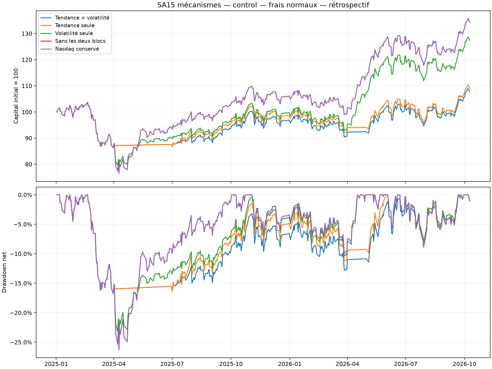
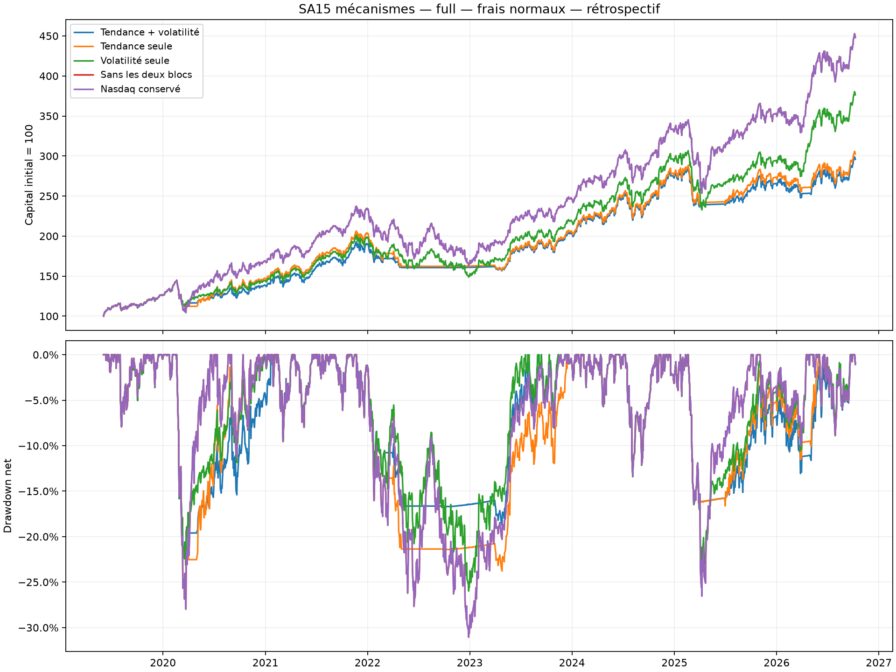

# SA15 — pilote d'attribution par mécanismes

Une itération principale préspécifiée : MA200 et plafond de volatilité historique 20 %, décisions mensuelles, bande 10 points, Nasdaq et monétaire EUR uniquement. Aucun poids n'est choisi pour une date passée ; aucun paramètre n'a été retouché après calcul.

**85 essais déclarés cumulativement** : 80 antérieurs et 5 politiques examinées ici. **30 simulations de base**, soit 5 politiques x 3 périodes x 2 barèmes de frais. Les quatre contrôles sont des ablations descriptives ; aucun ne remplace le candidat complet après lecture.

**Verdict principal : NOT_SUPPORTED.** le candidat complet ne bat pas Nasdaq sur le parcours complet; le candidat complet ne bat pas Nasdaq sur le controle 2025-2026.

Toutes les périodes sont rétrospectives et avaient déjà été examinées. Chaque période redémarre depuis 100 000 EUR de cash ; le contrôle 2025-2026 n'est pas un segment rebasé du parcours continu, ni une validation indépendante. Rendements en EUR, nets des frais simulés, avant fiscalité.

## choice (2019-06-03 au 2024-12-31) — frais normaux

| Politique | Gain net | CAGR | Drawdown | Dates d'ordres | Nasdaq moyen | Frais EUR |
| --- | --- | --- | --- | --- | --- | --- |
| Tendance + volatilité | 172.58% | 19.69% | -23.15% | 22 | 73.54% | 1396.66 |
| Tendance seule | 175.82% | 19.94% | -27.97% | 8 | 79.21% | 1318.45 |
| Volatilité seule | 193.41% | 21.28% | -25.98% | 20 | 88.04% | 655.55 |
| Sans les deux blocs | 230.24% | 23.88% | -31.05% | 1 | 98.78% | 97.82 |
| Nasdaq conservé | 230.24% | 23.88% | -31.05% | 1 | 98.78% | 97.82 |

## control (2025-01-02 au 2026-10-09) — frais normaux

| Politique | Gain net | CAGR | Drawdown | Dates d'ordres | Nasdaq moyen | Frais EUR |
| --- | --- | --- | --- | --- | --- | --- |
| Tendance + volatilité | 7.78% | 4.33% | -16.78% | 10 | 77.95% | 898.52 |
| Tendance seule | 9.15% | 5.08% | -16.78% | 5 | 81.31% | 816.27 |
| Volatilité seule | 27.36% | 14.68% | -23.96% | 9 | 90.32% | 392.46 |
| Sans les deux blocs | 34.32% | 18.19% | -26.30% | 1 | 98.34% | 98.42 |
| Nasdaq conservé | 34.32% | 18.19% | -26.30% | 1 | 98.34% | 98.42 |

## full (2019-06-03 au 2026-10-09) — frais normaux

| Politique | Gain net | CAGR | Drawdown | Dates d'ordres | Nasdaq moyen | Frais EUR |
| --- | --- | --- | --- | --- | --- | --- |
| Tendance + volatilité | 195.82% | 15.90% | -23.15% | 31 | 74.77% | 3610.88 |
| Tendance seule | 202.62% | 16.26% | -27.97% | 12 | 79.80% | 3312.76 |
| Volatilité seule | 276.35% | 19.76% | -25.98% | 28 | 88.73% | 1543.86 |
| Sans les deux blocs | 348.00% | 22.63% | -31.05% | 1 | 98.92% | 97.82 |
| Nasdaq conservé | 348.00% | 22.63% | -31.05% | 1 | 98.92% | 97.82 |

## Effets des blocs et interactions

Les comparaisons appariées sont de vrais rejeux depuis cash avec mêmes dates, données et conditions : complet-volatilité seule pour la tendance, complet-tendance seule pour la volatilité ; chaque bloc seul est aussi comparé au contrôle sans les deux. Le contrôle sans blocs conserve cadence/bande/fallback communs et est comparé au Nasdaq conservé.

| Période | Effet | Delta CAGR | Delta drawdown | Delta frais EUR |
| --- | --- | --- | --- | --- |
| choice | trend_conditional | -1.59 pp | 2.83 pp | 741.11 |
| choice | volatility_conditional | -0.25 pp | 4.82 pp | 78.21 |
| choice | trend_standalone | -3.93 pp | 3.08 pp | 1220.63 |
| choice | volatility_standalone | -2.60 pp | 5.07 pp | 557.73 |
| choice | common_conditions_vs_hold | 0.00 pp | 0.00 pp | 0.00 |
| choice | complete_vs_hold | -4.19 pp | 7.90 pp | 1298.84 |
| control | trend_conditional | -10.35 pp | 7.17 pp | 506.05 |
| control | volatility_conditional | -0.75 pp | 0.00 pp | 82.25 |
| control | trend_standalone | -13.10 pp | 9.52 pp | 717.84 |
| control | volatility_standalone | -3.51 pp | 2.35 pp | 294.04 |
| control | common_conditions_vs_hold | 0.00 pp | 0.00 pp | 0.00 |
| control | complete_vs_hold | -13.86 pp | 9.52 pp | 800.10 |
| full | trend_conditional | -3.86 pp | 2.83 pp | 2067.02 |
| full | volatility_conditional | -0.36 pp | 4.82 pp | 298.12 |
| full | trend_standalone | -6.37 pp | 3.08 pp | 3214.94 |
| full | volatility_standalone | -2.87 pp | 5.07 pp | 1446.04 |
| full | common_conditions_vs_hold | 0.00 pp | 0.00 pp | 0.00 |
| full | complete_vs_hold | -6.73 pp | 7.90 pp | 3513.06 |

Tendance, full: effet conditionnel CAGR -3.86 pp/an, drawdown +2.83 pp, frais +2067.02 EUR. Le signe est observe pour cet assemblage; les episodes et regimes permettent de localiser les hausses conservees ou manquees.

Tendance, control: effet conditionnel CAGR -10.35 pp/an, drawdown +7.17 pp, frais +506.05 EUR. Le signe est observe pour cet assemblage; les episodes et regimes permettent de localiser les hausses conservees ou manquees.

Volatilite, full: effet conditionnel CAGR -0.36 pp/an, drawdown +4.82 pp, frais +298.12 EUR. Le signe est observe pour cet assemblage; les episodes et regimes permettent de localiser les hausses conservees ou manquees.

Volatilite, control: effet conditionnel CAGR -0.75 pp/an, drawdown +0.00 pp, frais +82.25 EUR. Le signe est observe pour cet assemblage; les episodes et regimes permettent de localiser les hausses conservees ou manquees.

Un delta de drawdown positif indique une baisse maximale moins négative. Les drawdowns ne sont pas additifs. L'interaction publiée est log(croissance complète)-log(croissance tendance)-log(croissance volatilité)+log(croissance sans blocs). Elle mesure l'interaction des politiques dans ce simulateur ; elle ne prouve aucune causalité de marché.

| Période | Frais | Interaction log-croissance |
| --- | --- | --- |
| choice |  x 1 | 0.106423 |
| choice |  x 2 | 0.111778 |
| control |  x 1 | 0.040532 |
| control |  x 2 | 0.045407 |
| full |  x 1 | 0.151545 |
| full |  x 2 | 0.159488 |

## Régimes et épisodes publiés intégralement

Les labels descriptifs du jour t utilisent seulement la NAV Nasdaq connue à t-1 : hausse/baisse selon rendement 126 ; reprise prioritaire si rendement 21 positif et stress drawdown 10 % observé dans les 126 observations passées. Le drawdown est rapporté au maximum glissant 126. Il faut 127 closes pour le rendement 126 : les lignes 0 à 126 sont nonclassées après décalage ; la ligne 127 est la première classable. Aucun label ne pilote les ordres.

`regime_diagnostics.csv` contient, pour chaque politique/période/frais/régime, le nombre de rendements quotidiens, leur surplus moyen arithmétique en points de base et les expositions moyennes de clôture. Ce surplus moyen n'est pas une attribution composée de PnL. Aucun produit poids de clôture x rendement clôture/clôture n'est utilisé : les fills ont lieu à l'ouverture.

| Politique (full) | Regime | Jours | Surplus moyen bp/j | Nasdaq moyen |
| --- | --- | --- | --- | --- |
| Tendance + volatilité | unclassified | 126 | -0.188 | 96.93% |
| Tendance + volatilité | rise | 897 | 0.593 | 93.29% |
| Tendance + volatilité | fall | 223 | -9.055 | 12.62% |
| Tendance + volatilité | recovery | 639 | -5.207 | 66.21% |
| Tendance seule | unclassified | 126 | 0.000 | 98.14% |
| Tendance seule | rise | 897 | -0.306 | 95.91% |
| Tendance seule | fall | 223 | -7.558 | 17.67% |
| Tendance seule | recovery | 639 | -3.832 | 75.38% |
| Volatilité seule | unclassified | 126 | -0.188 | 96.93% |
| Volatilité seule | rise | 897 | 0.905 | 96.15% |
| Volatilité seule | fall | 223 | -3.822 | 75.15% |
| Volatilité seule | recovery | 639 | -3.297 | 81.59% |
| Sans les deux blocs | unclassified | 126 | 0.000 | 98.14% |
| Sans les deux blocs | rise | 897 | 0.000 | 99.09% |
| Sans les deux blocs | fall | 223 | 0.000 | 98.89% |
| Sans les deux blocs | recovery | 639 | 0.000 | 99.01% |
| Nasdaq conservé | unclassified | 126 | 0.000 | 98.14% |
| Nasdaq conservé | rise | 897 | 0.000 | 99.09% |
| Nasdaq conservé | fall | 223 | 0.000 | 98.89% |
| Nasdaq conservé | recovery | 639 | 0.000 | 99.01% |

La reduction du drawdown est accompagnee d'une exposition Nasdaq plus faible. Elle ne demontre pas une creation de performance independante du cash. Dans les jours classes reprise, les deux blocs peuvent conserver une exposition reduite alors que Nasdaq monte; les comparaisons appairees quantifient leur effet net sans les confondre avec une simple observation.

`reduced_exposure_episodes.csv` publie tous les épisodes où l'exposition Nasdaq réelle de clôture est inférieure à 95 %, hors observation initiale de cash. Rendements entre clôture précédente et dernière clôture réduite ; frais observés pendant l'épisode et frais du jour de retour séparés. Ces frais ne sont pas imputés à un bloc. Sans journaux pré-bande, le CSV ne permet pas de séparer exactement seuils, bande et arrondis.

| Politique (full) | Premiere cloture reduite | Derniere | Jours | Gain net | Nasdaq | Frais observes EUR |
| --- | --- | --- | --- | --- | --- | --- |
| Tendance + volatilité | 2019-09-02 | 2019-09-30 | 21 | 1.48% | 1.69% | 12.09 |
| Tendance + volatilité | 2020-03-02 | 2020-12-31 | 215 | 13.71% | 38.10% | 360.93 |
| Tendance + volatilité | 2022-01-03 | 2023-04-28 | 340 | -16.31% | -17.67% | 843.80 |
| Tendance + volatilité | 2025-04-01 | 2025-07-31 | 85 | 5.60% | 16.09% | 779.69 |
| Tendance + volatilité | 2025-12-01 | 2025-12-31 | 21 | -0.70% | -0.71% | 73.99 |
| Tendance + volatilité | 2026-04-01 | 2026-04-30 | 20 | 2.13% | 14.69% | 501.21 |
| Tendance + volatilité | 2026-07-01 | 2026-07-31 | 23 | -6.78% | -7.51% | 55.71 |
| Tendance seule | 2020-04-01 | 2020-04-30 | 20 | -4.26% | 12.70% | 110.22 |
| Tendance seule | 2022-03-01 | 2022-03-31 | 23 | -0.00% | 6.44% | 174.84 |
| Tendance seule | 2022-05-02 | 2023-03-31 | 239 | -1.27% | -3.52% | 323.28 |
| Tendance seule | 2025-04-01 | 2025-06-30 | 62 | 1.50% | 9.20% | 481.14 |
| Tendance seule | 2026-04-01 | 2026-04-30 | 20 | 2.13% | 14.69% | 515.63 |
| Volatilité seule | 2019-09-02 | 2019-09-30 | 21 | 1.48% | 1.69% | 12.09 |
| Volatilité seule | 2020-03-02 | 2020-12-31 | 215 | 18.51% | 38.10% | 282.77 |
| Volatilité seule | 2022-01-03 | 2023-04-28 | 340 | -13.62% | -17.67% | 174.25 |
| Volatilité seule | 2025-04-01 | 2025-07-31 | 85 | 8.62% | 16.09% | 362.77 |
| Volatilité seule | 2025-12-01 | 2025-12-31 | 21 | -0.70% | -0.71% | 81.42 |
| Volatilité seule | 2026-07-01 | 2026-07-31 | 23 | -6.76% | -7.51% | 73.18 |

## Frais doubles et limites du verdict

Les 30 simulations incluent de vrais rejeux aux frais doubles, sans changer les règles. Les statistiques complètes sont dans `reported_metrics.csv` et les contrastes dans `paired_effects.csv`. Le brut représente les mêmes transactions avec frais réintégrés ; ce n'est pas une politique qui aurait dimensionné autrement ses ordres sans frais.

Les redémarrages annuels, les voisinages de paramètres non sélectionnables et une observation future réellement inconnue restent à publier avant toute conclusion de robustesse. Aucun meilleur contrôle ne devient automatiquement une nouvelle stratégie. Une prochaine correction devra expliquer un défaut observé et faire l'objet d'un nouveau contrat avant son backtest.

## Diagnostic de selection descriptif

DSR absolu du candidat complet sur la tranche continue 2023-2024 avec cloture precedente: 0.9462043576500164. Compte 85; dispersion de Sharpe heritee des 80 courbes anterieures (0.01776811), non reestimee sur 85. C'est une approximation descriptive, pas une probabilite de battre Nasdaq ni une validation future. Aucun choix de politique ne depend de ce chiffre.
