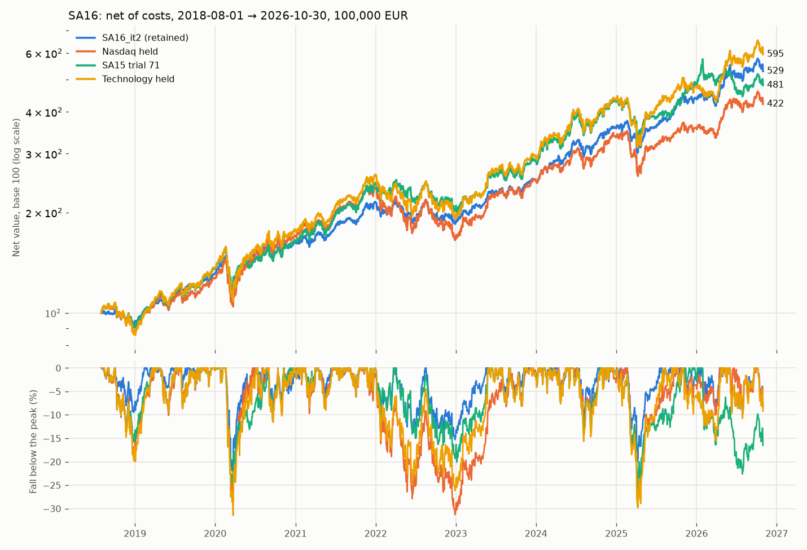
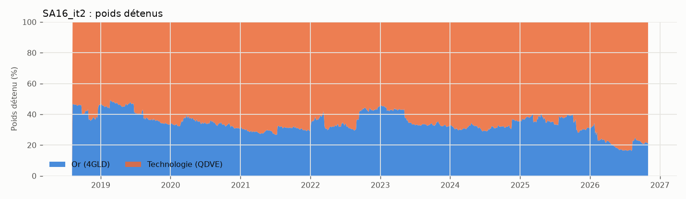

# SA16 — technologie et or sous budget de risque — étude du 31 octobre 2026

**Verdict.** La configuration retenue, **SA16_it2** (`SA16RiskBudget`), bat net
de coûts le Nasdaq-100 conservé et la dernière sélection archivée de SA15, sur
toute la fenêtre et sous tous les contrôles de robustesse déclarés : CAGR
22,40 % contre 19,09 % et 20,97 %, Sharpe 1,321 contre 0,942 et 1,064, perte
maximale −22,3 % contre −31,3 % et −25,7 %. Coûts doublés, 7 voisins sur 7
et 7 redémarrages depuis le cash sur 7 tiennent l'ordre. La supériorité de
**Sharpe** est établie par le bootstrap apparié (intervalles à 90 % au-dessus
de zéro contre les deux références). Celle de **rendement** ne l'est pas : ses
intervalles contiennent zéro. Statut au sens strict du protocole :
**UNCERTAIN**.

Trois limites pèsent sur la lecture :

- **L'avantage en rendement vient surtout du choix de la technologie**,
  hérité de SA15, qui l'a fait après avoir vu 2019–2024. La même règle sur le
  Nasdaq bat les deux références en Sharpe, mais pas en CAGR.
- **La technologie conservée seule fait mieux en CAGR** (24,14 %), au prix
  d'une perte maximale de −31,4 % et d'un Sharpe de 1,041.
- **Toute l'histoire avait déjà été examinée** : l'étude est rétrospective.

Trois candidats sur les dix autorisés ont été utilisés ; le cahier des
charges prévoit l'arrêt quand une stratégie domine ses références avec une
robustesse documentée.





## 1. Références, données, conventions

- **SA(N−1) = SA15, essai 71 de R4** (`results/SA15_GPT-6.1_R4/selected.json`,
  `SA15RiskAwareRotation`, mensuel, empreinte `ef95006960c2…`). R5 s'est
  arrêté à M34 sans sélection ni rapport (le README de SA15 renvoie à un
  `selected.json` et un `study.md` de R5 qui n'existent pas) : R4 est la
  dernière configuration explicitement retenue et archivée. Détail :
  [protocole](../../research/SA16/protocol.md), section 1.
- **Reproduction** : sur le magasin reconstruit, l'essai 71 et le Nasdaq
  conservé retombent au centime sur l'archive SA15 (499 693,44 EUR et
  448 002,97 EUR au 2026-10-09 ; écart relatif maximal 0 sur 1 886 séances ;
  `reproduction/reproduction.json`).
- **Magasin** `runs/sa16_store` (`scripts/SA16_download_data.py`), empreinte
  `677397e6fb770978…` pour tous les runs de l'étude : registre du projet,
  ajouts SA15 et séries de signal SA16 (`research/SA16/instruments.toml` :
  `^NDX`, GLD, HYG, IEF, VIX3M). Historiques Yahoo/FRED restatés, source
  unique, pas de millésimes. QDVE, 4GLD et trois autres fonds Xetra n'ont pas
  de barre le 2025-10-24 ni le 2026-03-06 ; aucun prix n'est reconstitué.
- **Conventions de SA15** : calendrier XPAR, 100 000 EUR, parts entières,
  commission 5 pb (min. 1 EUR), demi-spread 3 pb, glissement 2 pb, quantités
  fixées à la décision de 23:00 Paris, exécution à l'ouverture suivante du
  fonds sur sa place, Sharpe sur 252 séances, taux sans risque nul ; coûts ×2
  = second vrai run.
- **Fenêtre** : 2018-08-01 → 2026-10-30, 2 113 séances : premier mois où
  toutes les entrées des références sont lisibles, jusqu'à la dernière séance
  complète avant l'étude.

## 2. La stratégie retenue : SA16_it2

Chaque fin de semaine (dernière séance XPAR), à 23:00 Paris :

1. volatilité annualisée `σ` de la **technologie américaine** (QDVE.DE,
   iShares S&P 500 Information Technology, coté en euros, non couvert) et de
   l'**or** (4GLD.DE, ETC Xetra-Gold) sur leurs 126 derniers rendements
   logarithmiques en euros, **chaque rendement divisé par la racine du nombre
   de séances qu'il couvre** (nouveau signal `SpanScaledVolatilitySignal`,
   au plus 3 séances par rendement) ; plancher 5 % ;
2. poids cibles `w ∝ b / σ` avec un **budget de risque** `b = 0,75` pour la
   technologie et `0,25` pour l'or, la somme faisant le livre entier ;
3. ordre seulement si un poids s'écarte de plus de **5 points** de sa cible ;
   exécution à l'ouverture Xetra suivante ;
4. une entrée illisible garde le livre (aucune ne l'a été).

Aucune prévision de direction, aucun levier, aucune vente à découvert, toujours
investi. Quand les prix écartent les poids, la bande vend ce qui a monté
contre l'autre et achète ce qui a baissé.

| Paramètre | Valeur | Paramètre | Valeur |
| --- | --- | --- | --- |
| `growth_id` | `ETF_US_TECH` | `hedge_id` | `ETF_GOLD` |
| `growth_risk_budget` | 0,75 | `volatility_returns` | 126 |
| `max_span_sessions` | 3 | `volatility_floor` | 0,05 |
| `rebalance_band` | 0,05 | `max_age_sessions` | 1 |
| `relative_lookback` / `momentum_tilt` | 0 / 0 (inactifs) | cadence | hebdomadaire |

Fichier : [`research/SA16/candidates/it02.json`](../../research/SA16/candidates/it02.json) ;
gel : [`selected.json`](selected.json), empreinte `66b3493a8970…`. Le rerun
avec le code final (commit `cedf642`, arbre propre) redonne la courbe au
centime sur les 2 113 séances, aux coûts ×1 et ×2. Les valeurs par défaut de
la classe sont celles de la configuration retenue, sauf l'identifiant
(`SA16_growth_gold_budget` au catalogue, `SA16_it2` dans les résultats).

## 3. Résultats sur la fenêtre complète

| Livre | Net total | Brut total | CAGR net | Vol. | Sharpe | Perte max. | Coûts EUR | Jours d'interv./an |
| --- | ---: | ---: | ---: | ---: | ---: | ---: | ---: | ---: |
| **SA16_it2** | **+429,5 %** | +430,2 % | **22,40 %** | 16,03 % | **1,321** | **−22,3 %** | 698 | 2,5 |
| SA16_it2, coûts ×2 | +427,6 % | +429,0 % | 22,35 % | 16,03 % | 1,319 | −22,3 % | 1 390 | 2,5 |
| Nasdaq conservé (SXRV) | +322,3 % | +322,4 % | 19,09 % | 20,49 % | 0,942 | −31,3 % | 100 | 0,1 |
| SA15 essai 71 | +380,6 % | +387,9 % | 20,97 % | 19,39 % | 1,064 | −25,7 % | 7 265 | 3,8 |
| SA15 essai 71, coûts ×2 | +369,8 % | +384,2 % | 20,64 % | 19,40 % | 1,049 | −25,8 % | 14 322 | 3,8 |
| *Technologie conservée (QDVE)* | +495,0 % | +495,1 % | 24,14 % | 22,99 % | 1,041 | −31,4 % | 100 | 0,1 |
| *Cible constante 2/3 techno – 1/3 or (C1)* | +409,4 % | +409,8 % | 21,83 % | 16,31 % | 1,273 | −22,7 % | 373 | 1,1 |
| *Même règle, Nasdaq au lieu de techno (C2)* | +304,0 % | +304,4 % | 18,45 % | 14,63 % | 1,212 | −21,1 % | 433 | 1,8 |
| *Nasdaq + or 50/50 dérivant* | +277,0 % | +277,1 % | 17,46 % | 13,39 % | 1,249 | −17,5 % | 100 | 0,1 |
| *Or conservé (4GLD)* | +233,2 % | +233,3 % | 15,71 % | 15,60 % | 0,999 | −22,8 % | 100 | 0,1 |

En italique : contrôles passifs ou d'ablation, jamais candidats. Le brut
garde les mêmes transactions sans frais (pas un portefeuille contrefactuel).

**Bootstrap apparié** (`paired_block_bootstrap`, blocs de 20 séances,
2 000 tirages, graine 1616, 90 %), SA16_it2 moins :

| Contre | ΔSharpe [IC 90 %] | Δrendement moyen annualisé [IC 90 %] |
| --- | --- | --- |
| Nasdaq conservé | **+0,380 [+0,209 ; +0,618]** | +1,9 pt [−2,2 ; +7,0] |
| SA15 essai 71 | **+0,258 [+0,028 ; +0,560]** | +0,6 pt [−4,1 ; +6,4] |
| C1, cible constante 2/3 – 1/3 | +0,048 [+0,001 ; +0,103] | +0,4 pt [−0,4 ; +1,3] |
| C2, Nasdaq comme croissance | +0,109 [−0,020 ; +0,239] | **+3,4 pts [+1,5 ; +5,5]** |

Lecture : la pondération par la volatilité n'ajoute presque rien au mélange
constant (C1 bat lui aussi les deux références) ; l'avantage en rendement sur
le Nasdaq vient du choix de la technologie (contre C2) ; le gain robuste de
SA16 est un gain de **risque** (Sharpe, perte maximale), pas de rendement.

## 4. Années et épisodes, défavorables compris

| Année | SA16_it2 | Nasdaq | SA15 | Technologie | C1 |
| --- | ---: | ---: | ---: | ---: | ---: |
| 2018 (dès août) | −6,3 % | −11,2 % | −7,7 % | −11,3 % | −7,3 % |
| 2019 | 39,5 % | 42,8 % | 46,6 % | 53,9 % | 41,5 % |
| 2020 | 24,1 % | 34,4 % | 21,7 % | 29,7 % | 24,3 % |
| 2021 | 32,5 % | 39,3 % | 48,8 % | 46,8 % | 32,3 % |
| 2022 | −13,7 % | −30,0 % | −17,2 % | −25,8 % | −15,3 % |
| 2023 | 35,3 % | 51,1 % | 41,9 % | 54,1 % | 38,1 % |
| 2024 | 42,2 % | 33,5 % | 48,8 % | 46,1 % | 42,2 % |
| 2025 | 23,4 % | 7,0 % | 13,6 % | 10,0 % | 22,6 % |
| 2026 (au 30 oct.) | 20,2 % | 17,7 % | −1,2 % | 24,7 % | 15,8 % |

**Années défavorables** : SA16 perd contre le Nasdaq en 2019 (−3,3 points),
2020 (−10,3), 2021 (−6,8) et 2023 (−15,8), et contre SA15 en 2019, 2021, 2023
et 2024. Ce sont les grandes années de la technologie, où le tiers d'or
freine. Il gagne en 2018, 2022, 2024, 2025 et 2026 contre le Nasdaq.

| Épisode | SA16_it2 | Nasdaq | SA15 | Technologie |
| --- | ---: | ---: | ---: | ---: |
| 2018T4 (oct.–déc.) | −6,7 % | −15,9 % | −12,8 % | −16,2 % |
| Krach 2020 (19 févr. – 31 mars) | −13,3 % | −18,0 % | −16,3 % | −19,3 % |
| Rebond 2020 (avril – août) | +27,3 % | +39,1 % | +21,0 % | +36,2 % |
| 2022 | −13,7 % | −30,0 % | −17,2 % | −25,8 % |
| Krach 2025 (19 févr. – 30 avril) | −12,3 % | −19,2 % | −16,4 % | −20,9 % |
| Rebond 2025 (mai – sept.) | +25,8 % | +22,9 % | +16,2 % | +33,7 % |

**Pertes maximales de SA16_it2** : −22,3 % du 2020-02-20 au 2020-03-23
(l'or baisse aussi pendant la crise de liquidité ; sommet retrouvé le
2020-06-23) ; −20,0 % du 2025-02-20 au 2025-04-07 (retrouvé le 2025-07-17) ;
−15,3 % d'août à décembre 2022, quand or et technologie baissent ensemble
(retrouvé le 2023-05-18). SA15 est, au 2026-10-30, dans une perte de −22,6 %
ouverte depuis le 2026-01-29.

## 5. Robustesse

| Contrôle | Résultat |
| --- | --- |
| Coûts doublés (vrai run) | CAGR 22,35 %, Sharpe 1,319 : bat SA15 ×2 (20,64 % ; 1,049) et le Nasdaq |
| 7 voisins déclarés (budget 0,70/0,80, volatilité 63/189, bande 0,03/0,08, mensuel) | 7/7 battent les deux références ; CAGR 21,77 à 22,85 %, Sharpe 1,273 à 1,361, perte max. −20,9 à −24,0 % |
| 7 redémarrages depuis le cash (2019 à 2025, jusqu'au 2026-10-30) | 7/7 battent les deux références en CAGR et en Sharpe |
| Sharpe déflaté (Bailey et López de Prado) | 0,999 pour 13 essais au registre |

Détail : [`robustness/SA16_it2/tables.md`](robustness/SA16_it2/tables.md).
Limites de ces tests :

- Les redémarrages partagent la même fin (2025–2026, très favorable à l'or)
  et ne sont pas indépendants.
- Les voisins ne varient qu'un paramètre à la fois.
- Le Sharpe déflaté mesure un Sharpe absolu contre le hasard, pas la
  probabilité de battre le Nasdaq. Il ne compte ni les 85 politiques de SA15,
  ni les choix d'univers antérieurs du projet.

## 6. Toutes les itérations

| Itération | Famille, mécanisme | CAGR | Sharpe | Perte max. | Coûts EUR | Statut |
| --- | --- | ---: | ---: | ---: | ---: | --- |
| [it1](../../research/SA16/it01.md) | Nasdaq tenu à la part des rendements 1/3/6/12 mois positifs du `^NDX` (clôture de New York), reliquat vers l'or selon sa propre tendance, puis monétaire | 15,54 % | 0,996 | −24,5 % | 15 024 | NOT_SUPPORTED |
| it1 C1 | même règle sans or | 12,48 % | 0,862 | −24,8 % | 10 275 | témoin |
| [**it2**](../../research/SA16/it02.md) | **technologie + or au budget de risque 75/25, inverse de la volatilité à portée normalisée** | **22,40 %** | **1,321** | **−22,3 %** | 698 | **retenue, UNCERTAIN** |
| it2 C1 | cible constante 2/3 – 1/3 | 21,83 % | 1,273 | −22,7 % | 373 | témoin |
| it2 C2 | même règle, Nasdaq comme croissance | 18,45 % | 1,212 | −21,1 % | 433 | témoin |
| [it3](../../research/SA16/it03.md) | it2 + budget incliné ±0,10 vers l'actif au meilleur rendement 6 mois | 20,48 % | 1,207 | −23,9 % | 4 028 | NOT_SUPPORTED |

- **it1**, timing directionnel par paliers : il vend dans les V et revient
  tard. En 2020, 0 % de Nasdaq les 20 mars et 3 avril, puis 75 % le 9 avril,
  après le rebond. Krach à −20,2 % contre −18,0 % pour le Nasdaq conservé,
  2023 à +34,4 % contre +51,1 %. L'or n'y est utile que **tenu** : contre son
  témoin sans or, Δrendement +2,8 pts [+0,2 ; +5,9]. De 2018-08 à 2018-12, le
  livre est resté en cash, faute de 252 séances d'historique pour l'or : son
  2018 n'est pas un effet de la règle.
- **it2** change de famille : diversification structurelle, rééquilibrage
  contrariant, aucune vente au creux. En 2020, la cible et le livre dérivent
  ensemble dans la bande et la règle ne passe aucun ordre.
- **it3** incline le budget selon le momentum relatif à 6 mois : en retard à
  chaque retournement (2019, 2020, début 2022). ΔSharpe contre it2 −0,115
  [−0,234 ; −0,005] ; coûts multipliés par six.
- **Écarté sans backtest**, après contrôle des données : un achat contrariant
  pendant les inversions VIX/VIX3M, trop précoce dans 3 des 6 inversions
  longues. Écarté sur les enseignements d'it1 et des filtres de SA15 R3/R5 :
  un plafond de volatilité du portefeuille vers le monétaire (même retard au
  rebond).

## 7. Exécution manuelle

SA16_it2 : 42 ordres en 21 jours d'intervention sur 8,25 ans (**2,5 jours par
an, exactement 2 ordres par jour d'intervention**, maximum 2 ; limite 20, cible
1 à 10). Rotation 0,35 fois le livre par an ; cash résiduel moyen 0,16 %.
Onze rejets, tous `INSUFFICIENT_CASH` : un achat réduit faute de cash après
une vente en parts entières et frais, comme les 19 de SA15. Aucune décision
n'a eu d'entrée illisible : la volatilité à portée normalisée traverse les deux
séances que Yahoo ne sert pas, là où SA15 perd la technologie six mois de
suite.

## 8. Ce qui est documenté et ce qui est propre à SA16

Briques documentées :

- **Budget de risque**, poids `b/σ` sans corrélation : Maillard, Roncalli,
  Teiletche (2010).
- **L'or couvre les actions** en moyenne et sert de refuge dans les chocs
  extrêmes ; l'acheter après le krach sous-performe : Baur, Lucey (2010).
- **Rendement de diversification par le rééquilibrage** : Willenbrock
  (2011), avec les critiques de Chambers (2014) et de Cuthbertson et al.
- **Volatilité et momentum** : la gestion par la volatilité améliore les
  actions (Harvey et al., 2018) mais déçoit souvent hors échantillon
  (Cederburg et al., 2020) ; l'avantage du momentum temporel vient surtout
  de la pondération par la volatilité (Kim, Tse, Wald, 2016).
- **Momentum** temporel et transversal : Moskowitz, Ooi, Pedersen (2012) ;
  Hurst, Ooi, Pedersen (2017) ; Asness, Moskowitz, Pedersen (2013) ;
  Goulding, Harvey, Mazzoleni (2023).

Propre à SA16, et à juger comme tel :

1. **`SpanScaledVolatilitySignal`** : un estimateur de volatilité au contrat
   `AVAILABLE_OBSERVATIONS` déclaré, qui divise chaque rendement par la racine
   des séances qu'il couvre et refuse un trou de plus de trois séances. Testé
   à la main, contre l'estimateur consécutif sans trou, et contre le futur.
2. **« Une entrée illisible garde le livre »** au lieu d'exclure le fonds,
   la cause des sorties forcées de SA15 en 2025–2026.
3. **Le choix de diversifier plutôt que de prévoir**, et sa mesure honnête :
   deux signaux directionnels (absolu, relatif) réfutés sur cette période
   avant de retenir une règle sans direction.

## 9. Limites

- **Rétrospectif** : toute la fenêtre a été vue par SA1–SA15.
- **Univers choisi après coup** : la technologie vient de SA15 R4, et SA15
  avait déjà publié des mélanges technologie/or constants (« compagnons » 55
  et 79). SA16 n'a pas cherché de poids sur l'historique : son budget 0,75 a
  été posé avant le run et ses voisins 0,70/0,80 tiennent. Mais son
  avantage en rendement dépend de ce choix (C2).
- **Concentration** : deux lignes, un secteur américain (quelques grandes
  capitalisations) et un ETC or (risque d'émetteur et de dépositaire, pas un
  OPCVM). Pas éligible au PEA.
- **Change** : les deux fonds sont cotés en euros mais exposés au dollar ;
  rien n'est couvert.
- **L'or a vécu une période exceptionnelle** (+34,6 % en 2024, +49,3 % en
  2025 en euros) qui pèse dans le résultat récent.
- **Données** : source unique (Yahoo pour les fonds), historiques restatés,
  pas de millésimes point-in-time ; deux séances Xetra absentes.
- **Statistique** : la différence de rendement n'est pas significative ; 8,25
  années seulement.
- **Provenance** : certains runs d'itération portent `dirty = True`. La cause
  est la présence d'exports non suivis sous `results/SA16` au moment du run,
  l'arbre de code étant celui du commit nommé. Le rerun final de la
  configuration retenue est sur arbre propre.

Une vérification prospective reste la seule preuve possible
(`research/PROTOCOL.md`, section 6) : configuration et magasin figés, départ à
la première séance XPAR suivant la mise à disposition du code, lecture après
252 séances.

## 10. Reproduire

Linux, macOS ou WSL (verrou `fcntl`), Python 3.12, `uv` :

```bash
uv sync --frozen --extra stats
uv run python scripts/SA16_download_data.py           # runs/sa16_store, fin 2026-10-30
uv run python scripts/SA16_run_study.py reproduce      # SA15 et Nasdaq contre l'archive SA15
uv run python scripts/SA16_run_study.py references
for n in 01 02 03; do
    uv run python scripts/SA16_run_study.py candidate research/SA16/candidates/it$n.json
done
uv run python scripts/SA16_run_study.py robustness research/SA16/candidates/it02.json
uv run python scripts/SA16_run_study.py finalise research/SA16/candidates/it02.json
uv run python scripts/SA16_report.py
```

Utiliser un nouveau dossier (`--output`) pour ne pas mêler un rerun aux
exports commités : le script refuse d'écraser un run différent dans un dossier
existant. Retélécharger ne garantit pas le même magasin (empreinte de l'étude
`677397e6fb770978…`) : les historiques sont restatés par le fournisseur.

| Fichier | Contenu |
| --- | --- |
| `selected.json` | configuration gelée, empreinte, vérification du rerun |
| `register.csv` | les 13 essais comptés (candidats, témoins, voisins) |
| `itNN/tables.md`, `itNN/report.json` | tableaux générés de chaque itération |
| `itNN/x1/<livre>/`, `x2/` | courbes, poids, ordres, exécutions, rejets, décisions |
| `references/`, `reproduction/` | les références sur la fenêtre SA16 ; la reproduction de SA15 |
| `robustness/SA16_it2/` | voisins et redémarrages |
| `final/` | rerun de la configuration retenue avec le code final |
| `comparison.png`, `weights.png` | figures (`scripts/SA16_report.py`) |

## Archived exports (2026-10-31)

Of the files in the table above, the repository keeps `study.md`,
`selected.json`, the `tables.md` files and the figures. The others
(`register.csv`, the `report.json` files, the books under `x1/` and `x2/`,
`references/`, `reproduction/`, `final/` and the rest of `robustness/`)
are no longer tracked; they are in the results archive `quant-backtester-results-7a2205d.tar.gz`
(SHA-256 `475440c48634efec917ea1e0a11397cc2ac2b917e631d09f672346a60e8a0583`),
attached to the Release [`results-archive-2026-10-31`](https://github.com/paulrivaudd/quant-backtester/releases/tag/results-archive-2026-10-31).
Restore it before running `scripts/SA16_report.py` or
`scripts/SA16_run_study.py reproduce`: [ARCHIVE.md](../ARCHIVE.md) says how.
